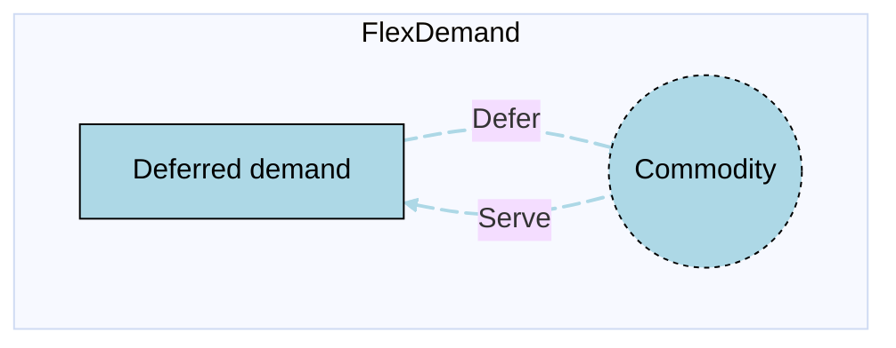

# Flexible Demand

## Contents

[Overview](@ref flexdemand_overview) | [Asset Structure](@ref flexdemand_asset_structure) | [Flow Equations](@ref flexdemand_flow_equations) | [Input File (Standard Format)](@ref flexdemand_input_file) | [Outputs](@ref flexdemand_outputs) | [Types - Asset Structure](@ref flexdemand_type_definition) | [Constructors](@ref flexdemand_constructors) | [Input File (Advanced Format)](@ref flexdemand_advanced_json_csv_input_format)

## [Overview](@id flexdemand_overview)

A `FlexDemand` asset is demand at a node that can be shifted in time, as the flexible demand resource of GenX. Part of the demand can be deferred and served up to `max_flexible_demand_delay` hours later, or served up to `max_flexible_demand_advance` hours in advance. The amount that can be shifted in each hour is bounded by the flexible capacity of the asset, which can be fixed or expanded.

The asset is a storage whose level is the deferred demand: positive when demand has been deferred and not yet served, negative when demand has been served in advance. The parameters have the same names and meaning as in GenX.

## [Asset Structure](@id flexdemand_asset_structure)

A flexible demand asset consists of three components:

1. **Storage Component**: the deferred demand. Its level is free, and it has no energy capacity.
2. **Defer Edge**: from the storage to the node. Its flow is the demand deferred in each hour, and its capacity is the flexible capacity.
3. **Serve Edge**: from the node to the storage. Its flow is the deferred or advanced demand served in each hour.

The edge directions follow from the node balance: deferring demand acts as supply at the node, and serving it acts as demand.



## [Flow Equations](@id flexdemand_flow_equations)

With $\Gamma$ the storage level (deferred demand), $\Pi$ the flow of the defer edge, $\Theta$ the flow of the serve edge and $\Delta$ the capacity of the defer edge:

```math
\begin{aligned}
\Gamma(t) &= \Gamma(t-1) + \Pi(t) - \eta \, \Theta(t) \\
\Pi(t) &\leq \rho(t) \, \Delta \\
\eta \, \Theta(t) &\leq \Delta \\
\sum_{k=1}^{\tau_d} \Theta(t+k) &\geq \Gamma(t) \\
\sum_{k=1}^{\tau_a} \Pi(t+k) &\geq -\Gamma(t)
\end{aligned}
```

where $\eta$ is `flexible_demand_energy_eff`, $\rho$ is the availability of the defer edge, and $\tau_d$ and $\tau_a$ are `max_flexible_demand_delay` and `max_flexible_demand_advance` in time steps (hours divided by the hours per time step, rounded down). The storage balance is circular within each subperiod, and `t + k` wraps within the subperiod, as in GenX. The last three constraints are the [`FlexDemandConstraint`](@ref flex_demand_constraint_ref), which the asset adds to its storage.

!!! note "Behavior inherited from GenX"
    - With $\eta < 1$, the delay window sums the served demand $\Theta$ while the deferred demand falls by $\eta \, \Theta$, so part of a deferral can be served later than $\tau_d$.
    - $\Pi$ and $\Theta$ can both be positive in the same hour, which serves older deferred demand and defers new demand. $\Pi$ is not bounded by the demand at the node, so $\rho(t) \, \Delta$ should not exceed the demand that can be deferred in hour $t$.
    - GenX's contribution of flexible demand to a capacity reserve margin is not modeled.

## [Input File (Standard Format)](@id flexdemand_input_file)

A flexible demand asset is added by placing a JSON or CSV file in the `assets` directory, as for any other asset. The following is an example of flexible electricity demand at node `elec_MA`, whose flexible capacity of 800 MW can be expanded:

```json
{
    "flexible_demand": [
        {
            "type": "FlexDemand",
            "instance_data": [
                {
                    "id": "MA_flex",
                    "storage_commodity": "Electricity",
                    "flexible_demand_energy_eff": 0.95,
                    "max_flexible_demand_delay": 3,
                    "max_flexible_demand_advance": 2,
                    "defer_end_vertex": "elec_MA",
                    "defer_existing_capacity": 800,
                    "defer_can_expand": true,
                    "defer_investment_cost": 5000,
                    "defer_variable_om_cost": 1.0,
                    "defer_availability": {
                        "timeseries": {
                            "path": "system/flex_availability.csv",
                            "header": "MA_flex"
                        }
                    },
                    "serve_start_vertex": "elec_MA",
                    "serve_variable_om_cost": 0.5
                }
            ]
        }
    ]
}
```

### Essential Attributes
| Field | Type | Description | Units |
|-------|------|-------------|-------|
| `type` | String | Asset type identifier: "FlexDemand" | - |
| `id` | String | Unique identifier for the asset | - |
| `storage_commodity` | String | Commodity of the flexible demand | - |
| `flexible_demand_energy_eff` | Float64 | Energy efficiency of serving deferred demand, $\eta > 0$ | fraction |
| `max_flexible_demand_delay` | Float64 | Hours that deferred demand can wait before it is served, $\geq 0$ | h |
| `max_flexible_demand_advance` | Float64 | Hours that demand can be served in advance, $\geq 0$ | h |

The three flexible demand parameters are required, as in GenX.

### Defer Edge Parameters
| Field | Type | Description | Units | Default |
|-------|------|-------------|-------|---------|
| `defer_end_vertex` | String | ID of the node of the flexible demand (instead of `location`) | - | - |
| `defer_availability` | Float64 or time series | Fraction of the flexible capacity that can be deferred in each hour, $\rho$ | fraction | 1.0 |
| `defer_existing_capacity` | Float64 | Existing flexible capacity, $\Delta$ | unit/h | 0.0 |
| `defer_can_expand` | Boolean | Whether the flexible capacity can be expanded | - | false |
| `defer_can_retire` | Boolean | Whether the flexible capacity can be retired | - | false |
| `defer_investment_cost` | Float64 | CAPEX per unit of flexible capacity | \$/(unit/h) | 0.0 |
| `defer_fixed_om_cost` | Float64 | Fixed O&M cost per unit of flexible capacity | \$/(unit/h)/yr | 0.0 |
| `defer_variable_om_cost` | Float64 | Cost per unit of deferred demand (GenX `var_om_cost_per_mwh_in`) | \$/unit | 0.0 |

### Serve Edge Parameters
| Field | Type | Description | Units | Default |
|-------|------|-------------|-------|---------|
| `serve_start_vertex` | String | ID of the node of the flexible demand (instead of `location`) | - | - |
| `serve_variable_om_cost` | Float64 | Cost per unit of served demand (GenX `var_om_cost_per_mwh`) | \$/unit | 0.0 |

Units are those of the commodity, for example MWh for Electricity. The defer and serve edges must connect to the same node.

### Constraints and restrictions
- The storage `BalanceConstraint` and the defer edge `CapacityConstraint` are on by default, and setting either to `false` raises an error.
- The asset adds the [`FlexDemandConstraint`](@ref flex_demand_constraint_ref) to its storage from the three flexible demand parameters. Listing it, or any other storage constraint, in the input raises an error.
- The storage has no energy capacity: `storage_can_expand` must be false and `storage_existing_capacity` 0. A storage `loss_fraction` and `long_duration` are not supported.
- The defer edge must have `has_capacity = true`, the default.

## [Outputs](@id flexdemand_outputs)

- The storage level is the deferred demand $\Gamma$, which is negative when demand has been served in advance.
- The flexible capacity is the capacity of the defer edge. The storage capacity is always 0.
- As for every edge from a node to a storage, the flow of the serve edge is written with a negative sign.

## [Types - Asset Structure](@id flexdemand_type_definition)

```julia
struct FlexDemand{T} <: AbstractAsset
    id::AssetId
    tags::AssetTags
    storage::Storage{<:T}
    defer_edge::Edge{<:T}
    serve_edge::Edge{<:T}
end
```

## [Constructors](@id flexdemand_constructors)

### Default constructor

```julia
FlexDemand(id::AssetId, tags::AssetTags, storage::Storage{T}, defer_edge::Edge{T}, serve_edge::Edge{T}) where {T<:Commodity}
```

### Factory constructor

```julia
make(asset_type::Type{FlexDemand}, data::AbstractDict{Symbol,Any}, system::System)
```

| Field | Type | Description |
|-------|------|-------------|
| `asset_type` | `Type{FlexDemand}` | Macro type of the asset |
| `data` | `AbstractDict{Symbol,Any}` | Dictionary containing the input data for the asset |
| `system` | `System` | System to which the asset belongs |

## [Input File (Advanced Format)](@id flexdemand_advanced_json_csv_input_format)

In the advanced format, the storage and the two edges are given as separate objects:

```json
{
    "flexible_demand": [
        {
            "type": "FlexDemand",
            "global_data": {
                "storage": {
                    "commodity": "Electricity"
                },
                "edges": {
                    "defer_edge": {
                        "commodity": "Electricity"
                    },
                    "serve_edge": {
                        "commodity": "Electricity"
                    }
                }
            },
            "instance_data": [
                {
                    "id": "MA_flex",
                    "flexible_demand_energy_eff": 0.95,
                    "max_flexible_demand_delay": 3,
                    "max_flexible_demand_advance": 2,
                    "edges": {
                        "defer_edge": {
                            "end_vertex": "elec_MA",
                            "existing_capacity": 800,
                            "can_expand": true,
                            "investment_cost": 5000,
                            "variable_om_cost": 1.0,
                            "availability": {
                                "timeseries": {
                                    "path": "system/flex_availability.csv",
                                    "header": "MA_flex"
                                }
                            }
                        },
                        "serve_edge": {
                            "start_vertex": "elec_MA",
                            "variable_om_cost": 0.5
                        }
                    }
                }
            ]
        }
    ]
}
```
