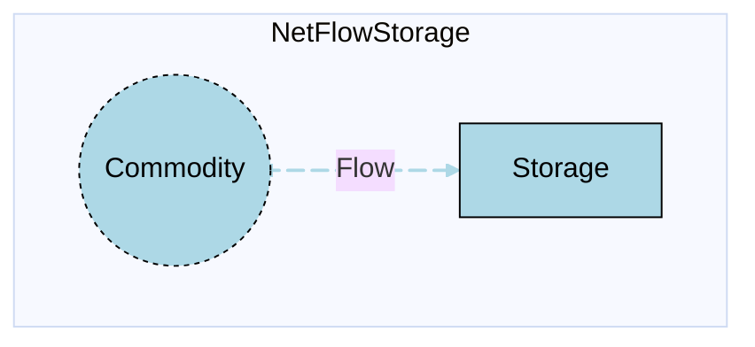

# Net Flow Storage

## Contents

[Overview](@ref netflowstorage_overview) | [Asset Structure](@ref netflowstorage_asset_structure) | [Flow Equations](@ref netflowstorage_flow_equations) | [Input File (Standard Format)](@ref netflowstorage_input_file) | [Types - Asset Structure](@ref netflowstorage_type_definition) | [Constructors](@ref netflowstorage_constructors) | [Examples](@ref netflowstorage_examples) | [Input File (Advanced Format)](@ref netflowstorage_advanced_json_csv_input_format)

## [Overview](@id netflowstorage_overview)

A `NetFlowStorage` asset is a storage of any Commodity connected to its node by a single signed flow edge: a positive flow charges the storage, a negative flow discharges it. With a lossless edge, the storage and node balances read one free variable per time step, so the storage cannot charge and discharge in the same time step.

Storage assets with separate charge and discharge edges, such as [Battery](@ref) and [Gas Storage](@ref), have two non-negative flows per time step. When nothing in the model penalizes it, a solution can charge and discharge in the same time step. A `NetFlowStorage` with a lossless flow edge rules this out by construction. It suits stores whose charging and discharging share one connection to the network, such as liquid fuel and chemical tanks, thermal storage or CO₂ storage.

## [Asset Structure](@id netflowstorage_asset_structure)

A net flow storage asset consists of two components:

1. **Storage Component**: tracks the storage level over time.
2. **Flow Edge**: a `BidirectionalEdge` from the node to the storage.



## [Flow Equations](@id netflowstorage_flow_equations)

With a lossless flow edge, the storage balance is:

```math
\begin{aligned}
\text{storage\_level}(t) &= (1 - \text{loss\_fraction}(t)) \cdot \text{storage\_level}(t-1) + \text{flow}(t)
\end{aligned}
```

where `flow` is the flow of the flow edge, positive when the storage charges. If the flow edge has a capacity (`has_capacity = true`), the capacity bounds the flow in both directions, $|\text{flow}(t)| \leq \text{capacity}$, and it is the power of the storage.

With a loss on the flow edge (`flow_loss_fraction`), Macro splits the flow into non-negative parts for each direction, $\text{flow}(t) = \text{flow\_pos}(t) - \text{flow\_neg}(t)$, and the loss applies in both directions. The storage receives $(1 - \text{flow\_loss\_fraction}(t)) \cdot \text{flow\_pos}(t)$, and the node receives $(1 - \text{flow\_loss\_fraction}(t)) \cdot \text{flow\_neg}(t)$:

```math
\begin{aligned}
\text{storage\_level}(t) &= (1 - \text{loss\_fraction}(t)) \cdot \text{storage\_level}(t-1) + (1 - \text{flow\_loss\_fraction}(t)) \cdot \text{flow\_pos}(t) - \text{flow\_neg}(t)
\end{aligned}
```

The round-trip efficiency is then $(1 - \text{flow\_loss\_fraction})^2$. As on any lossy bidirectional edge, such as a transmission line, both parts can be positive in the same time step, so the storage can charge and discharge at once. Doing so dissipates energy, so a solution does it only when that lowers the cost, for example to absorb a surplus that has nowhere else to go. A standing loss is set on the storage with `storage_loss_fraction`.

A `variable_om_cost` on the flow edge is charged on $|\text{flow}(t)| = \text{flow\_pos}(t) + \text{flow\_neg}(t)$. On a lossless edge, Macro adds the two parts only to price this cost: the storage and node balances still read the single signed flow.

## [Input File (Standard Format)](@id netflowstorage_input_file)

A net flow storage asset is added by placing a JSON or CSV file in the `assets` directory, as for any other asset. The following is an example of a methanol tank:

```json
{
    "methanol_storage": [
        {
            "type": "NetFlowStorage",
            "instance_data": [
                {
                    "id": "methanol_tank_SE",
                    "location": "SE",
                    "storage_commodity": "Methanol",
                    "storage_can_expand": true,
                    "storage_can_retire": false,
                    "storage_investment_cost": 2500,
                    "storage_fixed_om_cost": 50
                }
            ]
        }
    ]
}
```

The flow edge starts at the node of the storage Commodity at the asset `location`. Use `flow_start_vertex` to connect it to a node by its ID instead.

### Essential Attributes
| Field | Type | Description |
|-------|------|-------------|
| `type` | String | Asset type identifier: "NetFlowStorage" |
| `id` | String | Unique identifier for the asset |
| `location` | String | Location of the asset, used to find the node of the flow edge |
| `storage_commodity` | String | Commodity stored and carried by the flow edge |

### Storage Parameters
The storage accepts the same parameters as the storage component of other storage assets, prefixed with `storage_`, for example `storage_can_expand`, `storage_can_retire`, `storage_existing_capacity`, `storage_investment_cost`, `storage_fixed_om_cost`, `storage_loss_fraction`, `storage_min_storage_level`, `storage_max_storage_level`, `storage_min_duration`, `storage_max_duration` and `storage_long_duration`. See the storage parameters of the [Battery](@ref) asset for their descriptions.


### Flow Edge Parameters
| Field | Type | Description | Units | Default |
|-------|------|-------------|-------|---------|
| `flow_start_vertex` | String | ID of the node the storage is connected to (instead of `location`) | - | - |
| `flow_has_capacity` | Boolean | Whether the flow edge has a capacity, which bounds the flow in both directions | - | false |
| `flow_can_expand` | Boolean | Whether the flow capacity can be expanded | - | false |
| `flow_can_retire` | Boolean | Whether the flow capacity can be retired | - | false |
| `flow_existing_capacity` | Float64 | Existing flow capacity | unit/h | 0.0 |
| `flow_investment_cost` | Float64 | CAPEX per unit of flow capacity | \$/(unit/h) | 0.0 |
| `flow_fixed_om_cost` | Float64 | Fixed O&M costs per unit of flow capacity | \$/(unit/h)/yr | 0.0 |
| `flow_variable_om_cost` | Float64 | Variable O&M cost per unit of flow in either direction | \$/unit | 0.0 |
| `flow_loss_fraction` | Float64 | Fraction of the flow lost on the edge, in either direction | fraction | 0.0 |

Units are those of the storage Commodity, for example MWh for Methanol and tonnes for CO₂.

### Constraints Configuration
The storage has the following constraints by default:
- [Balance constraint](@ref balance_constraint_ref)
- [Storage capacity constraint](@ref storage_capacity_constraint_ref)

The storage duration constraints (`StorageMinDurationConstraint`, `StorageMaxDurationConstraint`) relate the storage capacity to the capacity of the flow edge, so they need `flow_has_capacity = true`; without it they raise an error. The flow edge takes the place of the discharge edge in these constraints.

The following constraints read separate charge and discharge edges and raise an error on this asset:
- `MinStorageOutflowConstraint`
- `StorageChargeDischargeRatioConstraint`
- `StorageSymmetricCapacityConstraint`

!!! note "Long-duration storage with representative subperiods"
    With `storage_long_duration = true` and representative subperiods (for example after time-domain reduction), the `LongDurationStorageImplicitMinMaxConstraint` is added, as for other storage assets. It bounds the storage level within the non-representative subperiods, using what the flow edge delivers to the storage.

## [Types - Asset Structure](@id netflowstorage_type_definition)

```julia
struct NetFlowStorage{T} <: AbstractAsset
    id::AssetId
    tags::AssetTags
    storage::AbstractStorage{<:T}
    flow_edge::BidirectionalEdge{<:T}
end
```

## [Constructors](@id netflowstorage_constructors)

### Default constructor

```julia
NetFlowStorage(id::AssetId, tags::AssetTags, storage::AbstractStorage{T}, flow_edge::BidirectionalEdge{T}) where {T<:Commodity}
```

### Factory constructor

```julia
make(asset_type::Type{NetFlowStorage}, data::AbstractDict{Symbol,Any}, system::System)
```

| Field | Type | Description |
|-------|------|-------------|
| `asset_type` | `Type{NetFlowStorage}` | Macro type of the asset |
| `data` | `AbstractDict{Symbol,Any}` | Dictionary containing the input data for the asset |
| `system` | `System` | System to which the asset belongs |

## [Examples](@id netflowstorage_examples)

### Thermal storage with a power capacity

A thermal storage whose volume is two hours of its power: the flow edge has a capacity, and the duration constraints tie the storage capacity to it.

```json
{
    "heat_storage": [
        {
            "type": "NetFlowStorage",
            "global_data": {
                "storage_constraints": {
                    "StorageMinDurationConstraint": true,
                    "StorageMaxDurationConstraint": true
                },
                "flow_constraints": {
                    "CapacityConstraint": true
                }
            },
            "instance_data": [
                {
                    "id": "heat_tank_SE",
                    "location": "SE",
                    "storage_commodity": "Heat",
                    "storage_can_expand": true,
                    "storage_investment_cost": 1000,
                    "storage_loss_fraction": 0.01,
                    "storage_min_duration": 2,
                    "storage_max_duration": 2,
                    "flow_has_capacity": true,
                    "flow_can_expand": true,
                    "flow_investment_cost": 5000
                }
            ]
        }
    ]
}
```

## [Input File (Advanced Format)](@id netflowstorage_advanced_json_csv_input_format)

In the advanced format, the storage and the flow edge are given as separate objects:

```json
{
    "methanol_storage": [
        {
            "type": "NetFlowStorage",
            "instance_data": [
                {
                    "id": "methanol_tank_SE",
                    "location": "SE",
                    "storage": {
                        "commodity": "Methanol",
                        "can_expand": true,
                        "investment_cost": 2500,
                        "fixed_om_cost": 50,
                        "constraints": {
                            "BalanceConstraint": true,
                            "StorageCapacityConstraint": true
                        }
                    },
                    "edges": {
                        "flow_edge": {
                            "commodity": "Methanol",
                            "start_vertex": "methanol_SE"
                        }
                    }
                }
            ]
        }
    ]
}
```
