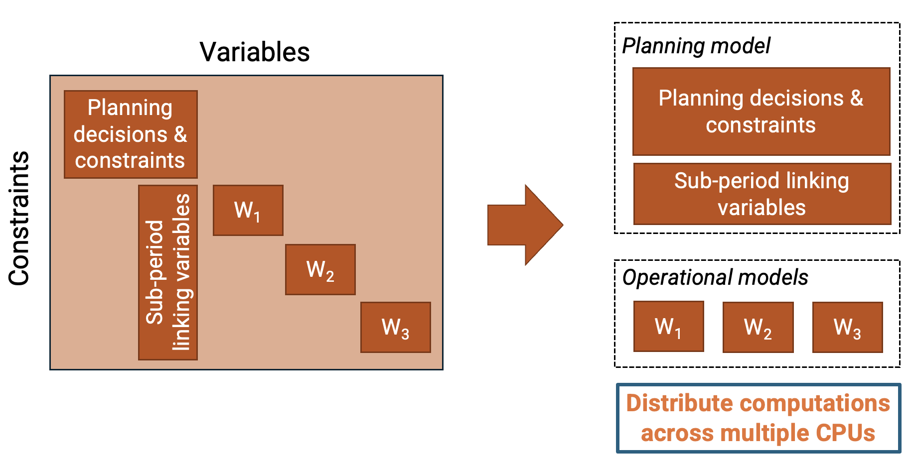

# Tutorial 1: Running Macro

!!! note "Interactive Notebook"
    The interactive version of this tutorial can be found [here](https://github.com/macroenergy/MacroEnergyExamples.jl/blob/main/tutorials/tutorial_1_running_macro.ipynb).

In this tutorial, we start from a single zone electricity system with four resource clusters: utility scale solar PV, land-based wind power generation, natural gas combined cycle power plants, and electricity storage. 

We consider three commodities: electricity, natural gas, and $\text{CO}_2$. 

Initially, hydrogen is modeled exogenously, adding a constant electricity demand for hydrogen production to the electricity demand time series. In other words, we assume the existence of an electrolyzer that continuously consumes electricity to meet the hydrogen demand.

We model a greenfield scenario with a carbon price of 200 USD/ton, i.e., we allow $\text{CO}_2$ emissions with a penalty cost.

**Note: We use the default units in Macro: MWh for energy vectors, metric tons for other commodities (e.g., $\text{CO}_2$) and dollars for costs**

```julia
using Pkg
Pkg.activate(".")
Pkg.add(name="MacroEnergy", rev="main")
Pkg.add(["VegaLite", "HiGHS", "CSV", "DataFrames", "JSON3"])
```

```julia
using MacroEnergy
using HiGHS
using CSV
using DataFrames
using JSON3
using VegaLite
```

## Quick Start: Using `run_case`

The simplest way to run a Macro case is using the `run_case` function, which handles loading inputs, solving the model, and writing outputs automatically:

```julia
using MacroEnergy
using HiGHS

(case, solution) = run_case(
    "one_zone_electricity_only";
    optimizer=HiGHS.Optimizer,
    optimizer_attributes=("solver" => "ipm", "run_crossover" => "on", "ipm_optimality_tolerance" => 1e-4)
);
```

This returns:
- `case`: A `Case` object containing a vector of solved `System` objects (one per period)
- `solution`: The solution object (a `Model` for Monolithic, `MyopicResults` for Myopic, or `BendersModel` for Benders)

You can customize the optimizer and other settings:

```julia
using MacroEnergy
using Gurobi

(case, solution) = run_case(
    "one_zone_electricity_only";
    optimizer=Gurobi.Optimizer,
    optimizer_attributes=("Method" => 2, "Crossover" => 0, "BarConvTol" => 1e-3)
);
```

## Step-by-Step: Manual Workflow

For more control over the workflow, you can load, generate, solve, and write outputs separately.

### Loading Inputs

We first load the inputs using `load_case`, which returns a `Case` object containing one or more systems (for multi-period planning):

```julia
case_dir = "one_zone_electricity_only"
case = load_case(case_dir);
```

### Setting the Optimizer

Next, we set the optimizer. Note that we are using the open-source LP solver [HiGHS](https://highs.dev/), alternatives include the commercial solvers [Gurobi](https://www.gurobi.com/), [CPLEX](https://www.ibm.com/products/ilog-cplex-optimization-studio), [COPT](https://www.copt.de/).

```julia
optimizer = HiGHS.Optimizer
optimizer_env = nothing
optimizer_attributes = (
    "solver" => "ipm",
    "run_crossover" => "on",
    "ipm_optimality_tolerance" => 1e-4
)
optimizer = create_optimizer(optimizer, optimizer_env, optimizer_attributes)
```

### Generating and solving the Model

We are now ready to generate and solve the capacity expansion model. Because Macro is designed to be solved by [high performance decomposition algorithms](https://arxiv.org/abs/2403.02559), the model formulation has a specific block structure that can be exploited by these schemes. In the case of 3 operational sub-periods, the block structure looks like this:



When generating the model, Macro by default decomposes it as described above. The user then has the option to solve it either as a monolithic model or using Benders decomposition. In this first run, we'll solve the model as a monolithic problem (see `settings/case_settings.json`).

The `solve_case` function generates the Macro model and solves it according to the solution algorithm (in this case, Monolithic) and the optimizer (HiGHS):

```julia
(case, solution) = solve_case(case, optimizer);
```

### Writing Outputs

To output the results to CSV files, you can use `write_outputs` which writes all results for all periods:

```julia
results_monolithic_path = joinpath(case_dir, "results_monolithic")
write_outputs(results_monolithic_path, case, solution)
```

Or write individual result types for a specific system (the last argument rescales the results; `1.0` leaves them unchanged):

```julia
system = case.systems[1];  # Get the first (or only) system
result_dir = joinpath(case_dir, "results_individual")
mkpath(result_dir)

write_capacity(joinpath(result_dir, "capacity.csv"), system, 1.0)
write_costs(joinpath(result_dir, "costs.csv"), system, solution, 1.0)
write_flow(joinpath(result_dir, "flow.csv"), system, 1.0)
```

### Viewing Results

Results can be directly visualized from the files exported to `results_monolithic/results`. In this tutorial, we'll take a different approach and inspect the results from the `case` variable returned by the `solve_case` function.

The `case` variable contains both the settings:

```julia
case.settings
```

and data for each period (a Macro `System`). Specifically, the case data is organized as a vector of investment periods, with each element containing the data for a given period.

```julia
typeof(case.systems)    # vector of data for each investment period
```

In this example, there is only one investment period, so to access the results, we need to retrieve the first element of this vector.

```julia
period_index = 1
system = case.systems[period_index]
typeof(system)
```

Once we have a `System` object, we can visualize the results with the following functions:

```julia
# Final capacity (the second argument rescales the results; 1.0 leaves them unchanged)
capacity_results = get_optimal_capacity(system, 1.0)
capacity_results[:, [:commodity, :resource_id, :resource_type, :value]]
```

```julia
# New capacity
new_capacity_results = get_optimal_new_capacity(system, 1.0)
new_capacity_results[:, [:commodity, :resource_id, :resource_type, :value]]
```

```julia
# Retired capacity
retired_capacity_results = get_optimal_retired_capacity(system, 1.0)
retired_capacity_results[:, [:commodity, :resource_id, :resource_type, :value]]
```

```julia
# Discounted costs
cost_results = get_optimal_discounted_costs(solution, 1.0)
select!(cost_results, Not(["case_name", "commodity", "zone", "resource_id", "component_id", "year", "type"]))
```

```julia
# Flows
flow_results = get_optimal_flow(system, 1.0)
MacroEnergy.reshape_wide(flow_results, :time, :component_id, :value)
```

The total system cost (in dollars) is:

```julia
MacroEnergy.objective_value(solution)
```

and the total emissions (in metric tonnes) are:

```julia
co2_node = MacroEnergy.find_node(system.locations, :co2_sink)
MacroEnergy.value(sum(co2_node.operation_expr[:emissions]))
```

We can also plot the electricity generation results using `VegaLite.jl`:

```julia
plot_time_interval = 3600:3624
natgas_power = MacroEnergy.value.(MacroEnergy.flow(system.assets[2].elec_edge))[plot_time_interval] / 1e3;
solar_power = MacroEnergy.value.(MacroEnergy.flow(system.assets[3].edge))[plot_time_interval] / 1e3;
wind_power = MacroEnergy.value.(MacroEnergy.flow(system.assets[4].edge))[plot_time_interval] / 1e3;

elec_gen = DataFrame(hours=plot_time_interval,
    solar_photovoltaic=solar_power,
    wind_turbine=wind_power,
    natural_gas_fired_combined_cycle=natgas_power,
)

stack_elec_gen = stack(elec_gen, [:natural_gas_fired_combined_cycle, :wind_turbine, :solar_photovoltaic], variable_name=:resource, value_name=:generation);

elc_plot = stack_elec_gen |>
           @vlplot(
    :area,
    x = {:hours, title = "Hours"},
    y = {:generation, title = "Electricity generation (GWh)", stack = :zero},
    color = {"resource:n", scale = {scheme = :category10}},
    width = 400,
    height = 300
)
```

### Exercise 1
Set a strict net-zero $\text{CO}_2$ cap by removing the slack allowing constraint violation for a penalty. This can be done by deleting the field `price_unmet_policy` from the $\text{CO}_2$ node in file `one_zone_electricity_only/system/nodes.json`

Then, re-run the model with these new inputs and show the capacity results, total system cost, emissions, and plot the generation profiles.

#### Solution

Open file `one_zone_electricity_only/system/nodes.json`, go to the bottom of the file where the $\text{CO}_2$ node is defined. Remove the lines related to the field `price_unmet_policy`, so that the node definition looks like this:

```json
 {
    "type": "CO2",
    "global_data": {
        "time_interval": "CO2"
    },
    "instance_data": [
        {
            "id": "co2_sink",
            "constraints": {
                "CO2CapConstraint": true
            },
            "rhs_policy": {
                "CO2CapConstraint": 0
            }   
        }
    ]
}
```

**Quick approach using `run_case`:**

```julia
(case, solution) = run_case(
    "one_zone_electricity_only";
    optimizer=HiGHS.Optimizer,
    optimizer_attributes=optimizer_attributes
);
```

**Manual approach for more control:**

Re-load the inputs:

```julia
case = load_case("one_zone_electricity_only");
```

Generate the Macro model and solve it:

```julia
(case, solution) = solve_case(case, optimizer);
```

We can check the results by printing the total system cost:

```julia
MacroEnergy.objective_value(solution)
```

and the new emissions (which should be zero):

```julia
system = case.systems[1];
co2_node = MacroEnergy.find_node(system.locations, :co2_sink);
MacroEnergy.value(sum(co2_node.operation_expr[:emissions]))
```

Finally, we plot the generation results:

```julia
plot_time_interval = 3600:3624
natgas_power = MacroEnergy.value.(MacroEnergy.flow(system.assets[2].elec_edge))[plot_time_interval] / 1e3;
solar_power = MacroEnergy.value.(MacroEnergy.flow(system.assets[3].edge))[plot_time_interval] / 1e3;
wind_power = MacroEnergy.value.(MacroEnergy.flow(system.assets[4].edge))[plot_time_interval] / 1e3;

elec_gen = DataFrame(hours=plot_time_interval, 
    solar_photovoltaic=solar_power,
    wind_turbine=wind_power,
    natural_gas_fired_combined_cycle=natgas_power,
)

stack_elec_gen = stack(elec_gen, [:natural_gas_fired_combined_cycle, :wind_turbine, :solar_photovoltaic], variable_name=:resource, value_name=:generation);

elc_plot = stack_elec_gen |> 
@vlplot(
    :area,
    x={:hours, title="Hours"},
    y={:generation, title="Electricity generation (GWh)", stack=:zero},
    color={"resource:n", scale={scheme=:category10}},
    width=400,
    height=300
)
```

## Benders Decomposition

To solve the model using Benders decomposition, the user needs to follow a few simple steps:

1. Set the `"SolutionAlgorithm"` field in the `settings/case_settings.json` file to `"Benders"`.
2. Create or update the `settings/benders_settings.json` file to configure the Benders decomposition algorithm.
3. Since the algorithm can be distributed, define two optimizers: one for solving the master problem and one for the subproblem.
4. All the other steps are the same as in the previous example.

Note that the considered test system includes slacks for the $\text{CO}_2$ cap policy and non-served energy demand. This ensures that all subproblems considered by the decomposition algorithm are feasible. If this was not the case, the algorithm would have to generate feasibility cuts, which can be looser than Benders optimality cuts and might result in slower convergence.

**Steps 1–2 (manual):** set `"SolutionAlgorithm": "Benders"` in `one_zone_electricity_only/settings/case_settings.json`, and check the Benders options in `one_zone_electricity_only/settings/benders_settings.json`.

!!! note "Restore the carbon price"
    If you completed Exercise 1, first restore the `price_unmet_policy` field of the $\text{CO}_2$ node in `one_zone_electricity_only/system/nodes.json` (with a value of 200), so that the model keeps the slack described above.

Let's re-load the inputs with the new settings:

```julia
case = load_case(case_dir);
```

**Step 3:** create the two optimizers mentioned above, one for the planning (master) problem and one for the subproblems:

```julia
planning_optimizer = HiGHS.Optimizer
subproblem_optimizer = HiGHS.Optimizer
planning_optimizer_attributes = ("solver" => "ipm", "run_crossover" => "on", "ipm_optimality_tolerance" => 1e-6)
subproblem_optimizer_attributes = ("solver" => "ipm", "run_crossover" => "on", "ipm_optimality_tolerance" => 1e-6)
optimizer = MacroEnergy.create_optimizer_benders(planning_optimizer, subproblem_optimizer, planning_optimizer_attributes, subproblem_optimizer_attributes)
```

**Step 4:** solve the model as in the monolithic run; this time, `solve_case` uses the Benders decomposition algorithm. Macro uses a Julia implementation of the algorithm, available at [MacroEnergySolvers.jl](https://github.com/macroenergy/MacroEnergySolvers.jl).

```julia
(case, solution) = solve_case(case, optimizer);
```

The runtime of Benders decomposition is longer than monolithic for this test system. This is because we are running the algorithm in series without taking advantage of distributed computing. In more realistic settings (for example on a computer cluster), Benders decomposition is expected to be significantly faster than monolithic model solution, especially for larger systems.

The results are written to the `results_benders` directory:

```julia
results_benders_path = joinpath(case_dir, "results_benders")
write_outputs(results_benders_path, case, solution)
```
