# Tutorial 3: MacroEnergy.jl showcase

!!! note "Interactive Notebook"
    The interactive version of this tutorial can be found [here](https://github.com/macroenergy/MacroEnergyExamples.jl/blob/main/tutorials/tutorial_3_macro_showcase.ipynb), next to the [`multisector_3zone_csv`](https://github.com/macroenergy/MacroEnergyExamples.jl/tree/main/tutorials/multisector_3zone_csv) case it uses.

!!! note "Workshop slides"
    The slides from the workshop's introductory talks, on energy-system optimization models and MACRO and on technology parameterization, are in [macro\_workshop\_intro.pdf](https://github.com/macroenergy/MacroEnergyExamples.jl/blob/main/tutorials/slides/macro_workshop_intro.pdf).

**A multisector energy system, from CSV inputs to insights**

Three zones of the US Eastern Interconnection (SE, MIDAT, NE), where electricity, hydrogen, natural gas, liquid fuels, biomass and CO₂ are planned and operated **together**: first with no climate policy, then under a CO₂ cap.

| | Section | What it shows |
|:-:|:---|:---|
| **1** | Inputs | Every asset is one row of a spreadsheet-like file |
| **2** | Inside the `System` | The graph Macro builds, and representative weeks |
| **3** | Solve | One call to `run_case`, and the run-status file |
| **4** | Results | Capacity, sector coupling, dispatch, prices and costs, with no climate policy |
| **5** | Scenario | Adding the CO₂ cap: what changes, and the carbon balance |

!!! details "Before you run: requirements"
    - **Requirements:** the development version of Macro (0.4), which is not registered yet. The first code cell installs MacroEnergy.jl from the `main` branch of its repository, together with HiGHS, CSV, DataFrames and Plots.
    - **Where files go:** the case folder (`multisector_3zone_csv/`, next to this notebook) is never modified. Each run works on a copy under `runs/`, and results are written inside that copy.

```julia
# Install the development version of Macro (0.4) and the packages used below into this folder's environment, as in the other tutorials.
using Pkg
Pkg.activate(".")
Pkg.add(name = "MacroEnergy", rev = "main")
Pkg.add(["HiGHS", "CSV", "DataFrames", "Plots"])

using MacroEnergy, HiGHS
using CSV, DataFrames, Plots
const ME = MacroEnergy   # shorthand for MacroEnergy helpers that are not exported

const CASE     = joinpath(@__DIR__, "multisector_3zone_csv")
const RUNS_DIR = joinpath(@__DIR__, "runs")
isdir(CASE) || error("Expected the case folder at $CASE")
ENV["DATAFRAMES_ROWS"] = 40
println("MacroEnergy ", pkgversion(MacroEnergy), " from ", pkgdir(MacroEnergy))
```

!!! details "Chart style and plotting helpers"
    ```julia
    # Chart style: light surface, hairline grid, thin marks.
    gr()
    const INK, INK2, HAIRLINE, SURFACE = "#0b0b0b", "#52514e", "#e1e0d9", "#fcfcfb"
    default(size = (900, 420), fontfamily = "sans-serif", background_color = SURFACE,
            titlefontsize = 12, titlefontcolor = INK, guidefontsize = 10, guidefontcolor = INK2,
            tickfontsize = 9, tickfontcolor = INK2, legendfontsize = 9, legendfontcolor = INK2,
            foreground_color_legend = nothing, background_color_legend = SURFACE,
            framestyle = :axes, foreground_color_axis = HAIRLINE, foreground_color_border = HAIRLINE,
            grid = :y, foreground_color_grid = HAIRLINE, gridalpha = 1, gridlinewidth = 0.5,
            linewidth = 2, margin = 4Plots.mm, legend = :outerright,
            plot_title = " ", plot_titlevspan = 0.04)   # blank figure title: leaves room above every chart title

    # Electricity technology groups. Colors follow the group in every chart, and this order is the
    # stacking order (bottom → top), checked for colorblind-safe contrast between neighbours.
    const TECH_ORDER  = ["Nuclear", "Hydro", "Natural gas", "Wind", "Other", "H₂ turbines", "Solar", "Battery"]
    const TECH_COLORS = Dict(zip(TECH_ORDER, ["#4a3aa7", "#2a78d6", "#eb6834", "#1baf7a", "#008300", "#e87ba4", "#eda100", "#e34948"]))
    const ZONES       = ["SE", "MIDAT", "NE"]
    const THREE       = ["#2a78d6", "#eb6834", "#1baf7a"]   # three-series palette (zones, representative weeks)
    const ZONE_COLORS = Dict(zip(ZONES, THREE))
    const BAR, NEUTRAL, REFERENCE = "#2a78d6", INK2, "#c3c2b7"   # single-series bars; neutral lines; reference (existing / base) bars
    const EMIT, REMOVE = "#e34948", "#2a78d6"               # diverging poles for the CO₂ balance

    "Format a number with thousands separators, e.g. 1159.04 → \"1,159\"."
    function fmt(x; digits = 0)
        r = round(abs(x); digits)
        whole = floor(Int, r)
        s = reverse(join(Iterators.partition(reverse(string(whole)), 3), ","))
        digits > 0 && (s *= "." * lpad(string(round(Int, (r - whole) * 10^digits)), digits, '0'))
        return (x < 0 ? "−" : "") * s
    end

    """
    Horizontal bars, largest at the top, each labelled with its value. There is no x axis, since every bar carries
    its number. `xmax` and `rows` give side-by-side panels one shared scale and row height; `ref` draws a labelled
    vertical reference line.
    """
    function hbar(labels, values; colors = fill(BAR, length(values)), title = "", digits = 0, unit = "",
                  xmax = nothing, rows = nothing, ref = nothing, ref_label = "")
        o = sortperm(values)
        labels, values, colors = labels[o], values[o], colors[o]
        n = length(values)
        rows = something(rows, n)
        y = (1:n) .+ (rows - n)                                 # bars aligned to the top row
        lo, hi = min(0, minimum(values)), something(xmax, max(0, maximum(values)))
        pad = 0.18 * (hi - lo)                                   # room for the value labels
        p = bar(y, values; orientation = :h, color = colors, linewidth = 0, bar_width = 0.62, legend = false)
        lo < 0 && vline!(p, [0]; subplot = 1, color = REFERENCE, linewidth = 1)
        if !isnothing(ref)
            vline!(p, [ref]; subplot = 1, color = "#898781", linewidth = 1)
            annotate!(p, ref, rows + 0.8, text(ref_label * " ", 8, INK2, :right); subplot = 1)
        end
        gap = 0.012 * (hi - lo)
        for (i, v) in enumerate(values)
            annotate!(p, v + (v < 0 ? -gap : gap), y[i], text(fmt(v; digits) * unit, 9, INK, v < 0 ? :right : :left); subplot = 1)
        end
        # With orientation = :h, Plots needs both axis limits set after the bars are drawn.
        # `subplot = 1` is the chart itself; the blank figure title (see `default` above) is a second subplot.
        plot!(p; subplot = 1, xlims = (lo < 0 ? lo - pad : 0, hi + pad), ylims = (0.4, rows + (isnothing(ref) ? 0.6 : 1.2)),
              yticks = (y, labels), ytickfontsize = 10, ytickfontcolor = INK, xticks = false,
              framestyle = :grid, grid = false, title, titlelocation = :left, size = (900, 80 + 30 * rows))
    end

    "Paired horizontal bars per category (top → bottom in the given order): a grey reference bar and a colored bar, both labelled. Values can be negative."
    function hbar_pair(labels, ref_values, values; colors, ref_label, label, title = "", digits = 0, unit = "")
        n = length(labels)
        lo, hi = min(0, minimum(vcat(ref_values, values))), max(0, maximum(vcat(ref_values, values)))
        pad, gap = 0.16 * (hi - lo), 0.012 * (hi - lo)
        p = bar((1:n) .- 0.19, ref_values; orientation = :h, bar_width = 0.36, linewidth = 0, color = REFERENCE, label = ref_label)
        bar!(p, (1:n) .+ 0.19, values; subplot = 1, orientation = :h, bar_width = 0.36, linewidth = 0, color = colors, label = label)
        lo < 0 && vline!(p, [0]; subplot = 1, color = REFERENCE, linewidth = 1, label = false)
        at(v) = v < 0 ? (v - gap, :right) : (v + gap, :left)       # label position and alignment for a bar ending at v
        for i in 1:n
            (x, h) = at(ref_values[i]); annotate!(p, x, i - 0.19, text(fmt(ref_values[i]; digits), 8, INK2, h); subplot = 1)
            (x, h) = at(values[i]);     annotate!(p, x, i + 0.19, text(fmt(values[i]; digits) * unit, 9, INK, h); subplot = 1)
        end
        plot!(p; subplot = 1, xlims = (lo < 0 ? lo - pad : 0, hi + pad), ylims = (0.4, n + 0.6), yticks = (1:n, labels), ytickfontsize = 10, ytickfontcolor = INK,
              yflip = true, xticks = false, framestyle = :grid, grid = false, legend = :outertop, legend_columns = 2,
              title, titlelocation = :left, size = (900, 130 + 44 * n))
    end
    ```

#### Setup helpers

Every run below works on a fresh copy of the case under `runs/`, so its inputs can be edited freely.

!!! tip "Try it"
    `CO2_PENALTY` sets the price of the soft CO₂ cap in the capped run (section 5). Lower it (e.g. to 200) and re-run to see a less aggressive system.

!!! details "Setup helpers"
    ```julia
    CO2_PENALTY = 1000.0   # $/t for net emissions above the cap

    "Fresh copy of the case at runs/<name>."
    function fresh_copy(name)
        dir = joinpath(RUNS_DIR, name)
        rm(dir; force = true, recursive = true)
        mkpath(RUNS_DIR)
        cp(CASE, dir)
        for f in readdir(dir)
            (startswith(f, "results") || endswith(f, ".log") || f == "run_status.json") && rm(joinpath(dir, f); recursive = true)
        end
        return dir
    end

    "Edit one asset CSV of a case: `f(df)` mutates the table, which is written back."
    function edit_csv!(f, dir, file)
        path = joinpath(dir, "assets", file)
        df = CSV.read(path, DataFrame)
        f(df)
        CSV.write(path, df)
        return df
    end

    "Edit a JSON input file of a case: `f(data)` mutates the parsed Dict, which is written back."
    function edit_json!(f, dir, file)
        path = joinpath(dir, file)
        data = ME.JSON3.read(read(path, String), Dict{String,Any})
        f(data)
        open(io -> ME.JSON3.pretty(io, data), path, "w")
        return data
    end

    """
    A working copy of the case with the notebook's output settings. With `co2_cap = true` (the case as shipped), the CO₂ cap
    on `co2_sink` stays and its penalty is set to `CO2_PENALTY`; with `co2_cap = false`, the cap is removed.
    """
    function prepare_case(name; co2_cap = true)
        dir = fresh_copy(name)
        edit_json!(dir, joinpath("system", "nodes.json")) do nodes
            for block in nodes["nodes"], node in block["instance_data"]
                node["id"] == "co2_sink" || continue
                if co2_cap
                    node["price_unmet_policy"] = Dict("CO2CapConstraint" => CO2_PENALTY)
                else
                    node["constraints"]["CO2CapConstraint"] = false
                    delete!(node, "rhs_policy")
                    delete!(node, "price_unmet_policy")
                end
            end
        end
        edit_json!(dir, joinpath("settings", "macro_settings.json")) do settings
            settings["OverwriteResults"] = true   # results go to <case>/results, without a _001 suffix
        end
        return dir
    end
    ```

## 1. Inputs

!!! tip
    A case is a folder of plain files: every asset is a row in a CSV file, and every commodity network is a set of nodes in JSON.

```text
multisector_3zone_csv/
├── system_data.json      ← index: paths to all the rest
├── assets/               ← 29 CSV files, one row per asset
├── system/
│   ├── commodities.json  ← commodities, sub-commodities
│   ├── locations.json    ← zones
│   ├── nodes.json        ← supply, demand, policies
│   ├── time_data.json    ← time steps, representative weeks
│   └── *.csv             ← demand, availability, fuel prices
└── settings/
    └── macro_settings.json
```

!!! details "system_data.json in full"
    ```json
    {
        "commodities": { "path": "system/commodities.json" },
        "locations":   { "path": "system/locations.json" },
        "settings":    { "path": "settings/macro_settings.json" },
        "assets":      { "path": "assets" },
        "time_data":   { "path": "system/time_data.json" },
        "nodes":       { "path": "system/nodes.json" }
    }
    ```

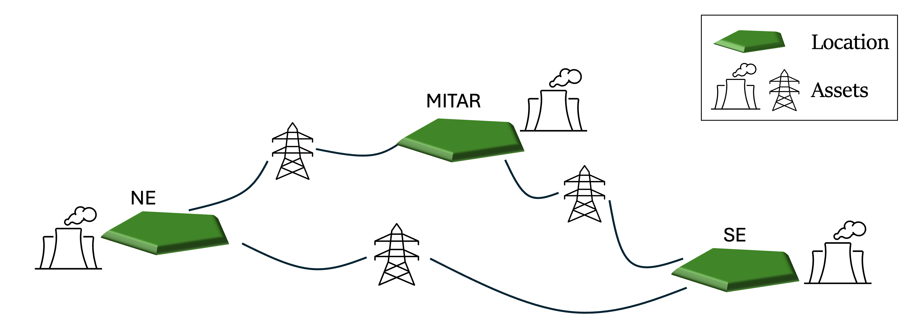

### Asset CSVs: one row per asset

`system_data.json` points Macro at the `assets/` **folder**, and Macro loads every `.json` *and* `.csv` file in it. For example, here is the file for natural-gas power plants:

```julia
thermal = CSV.read(joinpath(CASE, "assets/naturalgas_power.csv"), DataFrame)
select!(thermal, :Type, :id, :location, :existing_capacity, :fuel_consumption, :emission_rate, :can_retire, :can_expand, :annualized_investment_cost, :fixed_om_cost, :variable_om_cost, :min_up_time, :min_down_time, :ramp_down_fraction, :)
first(thermal, 5)
```

```
5×28 DataFrame
 Row │ Type          id                                            location  existing_capacity  fuel_consumption  emission_rate  can_retire  can_expand  annualized_investment_cost  fixed_om_cost  variable_om_cost  min_up_time  min_down_time  ramp_down_fraction
─────┼────────────────────────────────────────────────────────────────────────────────────────────────────────────────────────────────────────────────────────────────────────────────────────────────────────────────────────────────────────────────────────────────
   1 │ ThermalPower  MIDAT_natural_gas_fired_combined_cycle_1      MIDAT                4026.4           2.24961       0.181048     missing       false                         0.0       16001.0              4.415            6              6                0.64
   2 │ ThermalPower  MIDAT_natural_gas_fired_combined_cycle_2      MIDAT               31802.9           2.00255       0.181048     missing       false                         0.0       11965.0              3.452            6              6                0.64
   3 │ ThermalPower  MIDAT_natural_gas_fired_combined_cycle_3      MIDAT                1697.7           3.59862       0.181048        true       false                         0.0       11069.1              3.505            6              6                0.64
   4 │ ThermalPower  MIDAT_natural_gas_fired_combined_cycle_4      MIDAT               20288.5           2.10132       0.181048        true       false                         0.0        9496.0              3.504            6              6                0.64
   5 │ ThermalPower  MIDAT_natural_gas_fired_combustion_turbine_1  MIDAT               14508.8           3.44388       0.181048        true       false                         0.0        9573.46             5.071            1              1                0.64
14 columns omitted
```

In each CSV file:
- **`Type` and `id` are required.** `Type` is the asset type (`ThermalPower`, `Electrolyzer`, `VRE`, …), `id` is a unique identifier for the asset.
- **Every other column is a property:** where it is (`location`), what it costs (`annualized_investment_cost`, `fixed_om_cost`), how big it is or can get (`existing_capacity`, `max_capacity`), how it performs (`efficiency_rate`, `fuel_consumption`), and so on.
- **`--` expresses nesting.** `elec_constraints--CapacityConstraint = true` switches on a constraint, and `availability--timeseries--path` / `--header` point to a column of a time-series CSV.
- **Empty cells fall back to the asset's defaults**, so rows in one file don't need identical columns.

The following is an example for the variable renewable energy resources (note the `availability` column):

```julia
vre = CSV.read(joinpath(CASE, "assets/vre.csv"), DataFrame)
select!(vre, :Type, :id, :location, :annualized_investment_cost, :fixed_om_cost, Symbol("availability--timeseries--path"), Symbol("availability--timeseries--header"), Not(:existing_capacity, :elec_can_expand, :elec_can_retire))
first(vre, 5)
```

```
5×10 DataFrame
 Row │ Type     id                                             location  annualized_investment_cost  fixed_om_cost  availability--timeseries--path  availability--timeseries--header
─────┼─────────────────────────────────────────────────────────────────────────────────────────────────────────────────────────────────────────────────────────────────────────────────────────────
   1 │ VRE      NE_offshorewind_class10_moderate_floating_1_1  NE                          1.7383e5        57294.4  system/availability.csv         NE_offshorewind_class10_moderate_floating_1_1
   2 │ VRE      SE_utilitypv_class1_moderate_70_0_2_1          SE                      40649.0             13510.2  system/availability.csv         SE_utilitypv_class1_moderate_70_0_2_1
   3 │ VRE      SE_utilitypv_class1_moderate_70_0_2_2          SE                      39383.7             13510.2  system/availability.csv         SE_utilitypv_class1_moderate_70_0_2_2
   4 │ VRE      SE_utilitypv_class1_moderate_70_0_2_3          SE                      40720.2             13510.2  system/availability.csv         SE_utilitypv_class1_moderate_70_0_2_3
   5 │ VRE      SE_utilitypv_class1_moderate_70_0_2_4          SE                      42820.6             13510.2  system/availability.csv         SE_utilitypv_class1_moderate_70_0_2_4
3 columns omitted
```

Here are all the assets in the system, file by file:

```julia
asset_files = filter(endswith(".csv"), readdir(joinpath(CASE, "assets")))
inventory = DataFrame(file = String[], Type = String[], assets = Int[], columns = Int[])
for f in asset_files
    df = CSV.read(joinpath(CASE, "assets", f), DataFrame)
    push!(inventory, (f, join(unique(df.Type), ", "), nrow(df), ncol(df)))
end
println(length(asset_files), " CSV files describe ", sum(inventory.assets), " assets of ", length(unique(inventory.Type)), " types")
inventory
```

```
29 CSV files describe 215 assets of 23 types
29×4 DataFrame
 Row │ file                              Type                  assets  columns
─────┼─────────────────────────────────────────────────────────────────────────
   1 │ beccs_electricity.csv             BECCSElectricity           6       17
   2 │ beccs_gasoline.csv                BECCSGasoline              6       18
   3 │ beccs_hydrogen.csv                BECCSHydrogen              6       18
   4 │ beccs_liquid_fuels.csv            BECCSLiquidFuels          12       23
   5 │ beccs_naturalgas.csv              BECCSNaturalGas           12       17
   6 │ co2_injection.csv                 CO2Injection              12        7
   7 │ electricdac.csv                   ElectricDAC                3       13
   8 │ electricity_stor.csv              Battery                    6       28
   9 │ electrolyzer.csv                  Electrolyzer               3       14
  10 │ h2gas_power_ccgt.csv              ThermalPower               3       26
  11 │ h2gas_power_ocgt.csv              ThermalPower               3       22
  12 │ h2pipelines.csv                   GasStorage                 4       27
  13 │ h2storage.csv                     GasStorage                 3       27
  14 │ hydropower.csv                    HydroRes                   3       28
  15 │ liquid_fuels_end_use.csv          FuelsEndUse                9        7
  16 │ liquid_fuels_fossil_upstream.csv  FossilFuelsUpstream        9        7
  17 │ mustrun.csv                       MustRun                    3       10
  18 │ natgasdac.csv                     NaturalGasDAC              3       17
  19 │ naturalgas_end_use.csv            FuelsEndUse                3        9
  20 │ naturalgas_fossil_upstream.csv    FossilFuelsUpstream        3        8
  21 │ naturalgas_h2.csv                 ThermalHydrogen            3       26
  22 │ naturalgas_h2_ccs.csv             ThermalHydrogenCCS         6       27
  23 │ naturalgas_power.csv              ThermalPower              24       28
  24 │ naturalgas_power_ccs.csv          ThermalPowerCCS            3       27
  25 │ nuclear_power.csv                 ThermalPower               9       28
  26 │ powerlines.csv                    TransmissionLink           2       11
  27 │ synthetic_liquid_fuels.csv        SyntheticLiquidFuels       3       20
  28 │ synthetic_naturalgas.csv          SyntheticNaturalGas        3       15
  29 │ vre.csv                           VRE                       50       13
```

```julia
println("Total number of assets: ", sum(inventory.assets))
```

### Existing plants vs. new-build candidates

In the `nuclear_power.csv` file, we can notice that we have two *types* of nuclear plants (the table is transposed, so each plant is a column):

- **`SE_nuclear_1`** is an existing plant: it can't expand and has no `annualized_investment_cost` (an empty cell).
- **`SE_nuclear_mid_0`** is a new-build candidate: it starts at zero capacity and can expand.

```julia
"Transpose a table so each row becomes a column (easier to read wide asset files)."
function transposed(df)
    out = DataFrame(field = names(df))
    for r in eachrow(df)
        out[!, string(r.id)] = [ismissing(x) ? "" : string(x) for x in r]
    end
    return out
end

nuclear = CSV.read(joinpath(CASE, "assets", "nuclear_power.csv"), DataFrame)
select!(nuclear, :Type, :id, :can_retire, :can_expand, :existing_capacity, :annualized_investment_cost, :)
transposed(nuclear[in(["SE_nuclear_1", "SE_nuclear_mid_0"]).(nuclear.id), :])
```

```
28×3 DataFrame
 Row │ field                                     SE_nuclear_1    SE_nuclear_mid_0
─────┼────────────────────────────────────────────────────────────────────────────
   1 │ Type                                      ThermalPower    ThermalPower
   2 │ id                                        SE_nuclear_1    SE_nuclear_mid_0
   3 │ can_retire                                true            true
   4 │ can_expand                                false           true
   5 │ existing_capacity                         33632.288       0.0
   6 │ annualized_investment_cost                                231096.9481
22 rows omitted
```

The `can_expand` and `can_retire` parameters allow the model to build new capacity and to retire existing capacity; set them to `false` to prevent either.

### A new asset from a template

Starting a new asset from scratch is one call. `template_asset` writes a CSV with every simple-style column for that type, already filled with defaults:

```julia
template_dir = mktempdir()
template_asset(template_dir, Electrolyzer; style = "simple", format = "csv")
CSV.read(joinpath(template_dir, "Electrolyzer.csv"), DataFrame)
```

```
1×18 DataFrame
 Row │ Type          id            location  can_expand  can_retire  existing_capacity  capacity_size  efficiency_rate  investment_cost  fixed_om_cost
─────┼──────────────────────────────────────────────────────────────────────────────────────────────────────────────────────────────────────────────────
   1 │ Electrolyzer  Electrolyzer   missing        true        true                0.0            1.0              0.0              0.0            0.0
8 columns omitted
```

Each user can then modify the properties, add new rows, etc. Always remember to have unique ids for each asset.

### What an asset row doesn't say

The gas-plant rows say where each plant is, how big it is and how efficient. They don't say what the plant is **connected to**: there's no pipeline column and no grid connection for now. 

That's deliberate: in Macro, assets never connect to each other. Back to the map from the start: between the assets, there's a layer we haven't seen yet.


### Nodes: where commodities meet

That layer is **nodes**. Think of a node as a **market for one commodity in one place**: the SE electricity market, the SE gas market. Assets are the traders: a gas plant buys in the gas market and sells in the electricity market.

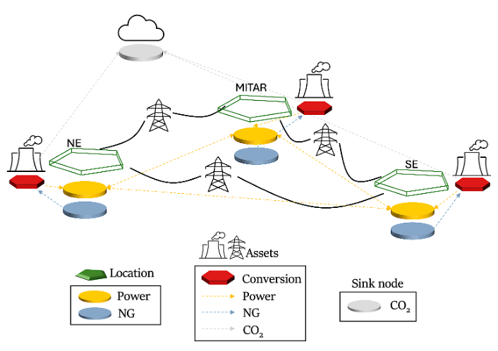

*The same map, now with nodes between the assets (only a few per zone, for simplicity).*

- **Every market clears every hour:** what flows in (production, imports, purchases) equals what flows out (consumption, exports, demand).
- **Each commodity has its own nodes in each zone:** `elec_SE`, `h2_SE`, `natgas_SE`, `gasoline_SE`, `co2_captured_SE`, and more. Fuels have three per zone: where the fuel is bought, a hub, and where it's used.
- **The atmosphere, `co2_sink`, is the exception.** It belongs to no zone and has no hourly balance: it adds up what's emitted and removed, and the CO₂ cap applies to that total.

!!! tip
    From power-system models? A node is a bus, for every commodity.

### How assets find their nodes

!!! tip
    Each edge of an asset is a **plug** for one commodity, and each node is a **socket** for one commodity in one zone. The asset's `location` picks the zone; the commodity picks the socket.

A gas plant with `location = SE` plugs its fuel edge into `natgas_SE` and its electricity edge into `elec_SE`. Nodes without a location are referenced by `id` instead, like the `co2_sink` column in many asset files, or `fuel_start_vertex = uranium_source` for nuclear plants.

### (Advanced) Following one unit of gas

Here's how nodes and assets fit together along one supply chain: natural gas in SE.

1. **Bought** at the supply node `natgas_fossil_SE`, at the fuel price.
2. **Moved** by an upstream asset to the zone hub `natgas_SE`. Bio-methane and synthetic methane arrive at the same hub, so they compete with fossil gas.
3. **Used** in one of two ways: an end-use asset delivers it to the demand node `natgas_demand_SE`, or a plant burns it; a gas power plant, for example, sends its electricity to `elec_SE`.

**Whichever asset burns the gas is charged its combustion CO₂:** the end-use asset for gas demand, or the plant itself.

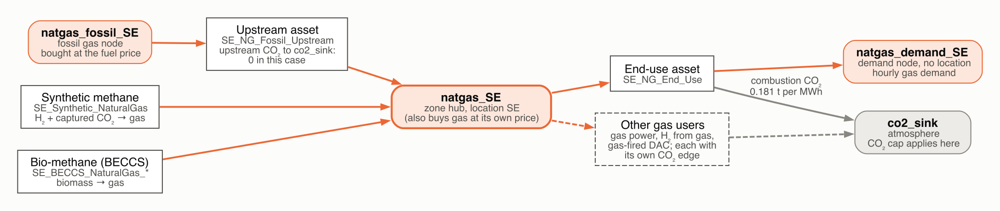

*Natural gas in the SE zone. Rounded boxes are nodes, square boxes are assets; orange arrows carry gas, grey arrows carry CO₂. Gasoline, diesel and jet fuel follow the same pattern: supply node, hub, demand node.*

### `nodes.json`: supply, demand and policies

All of those nodes, and the demand, supply and policies they carry, are defined in `system/nodes.json`, in blocks. Each block has:

- `type`: the commodity (`Electricity`, `Hydrogen`, `NaturalGas`, `CO2`, …)
- `global_data`: settings shared by every node in the block
- `instance_data`: one entry per node, each with a unique `id` and its own settings

A node can carry:

| | What it is | In this case |
|:---|:---|:---|
| **demand** | an hourly time series the system must serve | `elec_SE` reads column `Demand_MW_z1` of `system/demand fuel.csv` |
| **supply** | the commodity bought from outside the system at a price, optionally in segments with limits | biomass, fossil fuels, uranium |
| **non-served demand** | `max_nsd` and `price_nsd` let demand go unmet at a penalty | up to 100% of demand, at USD 5,000/MWh |
| **policies** | caps and limits | the CO₂ cap on `co2_sink` |
| **location** | the zone it belongs to | `SE`, `MIDAT`, `NE` |

```julia
nodes_json = ME.JSON3.read(read(joinpath(CASE, "system", "nodes.json"), String))
node_blocks = DataFrame(commodity = String[], nodes = Int[], ids = String[], sets = String[])
for block in nodes_json.nodes
    fields = Set{Symbol}()
    haskey(block, :global_data) && union!(fields, keys(block.global_data))
    foreach(n -> union!(fields, keys(n)), block.instance_data)
    sets = [string(f) for f in (:demand, :supply, :max_nsd, :rhs_policy, :price_unmet_policy) if f in fields]
    ids = [string(n.id) for n in block.instance_data]
    push!(node_blocks, (string(block.type), length(ids), length(ids) > 3 ? join(ids[1:2], ", ") * ", …" : join(ids, ", "), join(sets, ", ")))
end
node_blocks
```

```
21×4 DataFrame
 Row │ commodity          nodes  ids                                                            sets
─────┼─────────────────────────────────────────────────────────────────────────────────────────────────────────────────────────
   1 │ Fossil_NaturalGas      3  natgas_fossil_SE, natgas_fossil_MIDAT, natgas_fossil_NE        supply
   2 │ NaturalGas             3  natgas_SE, natgas_MIDAT, natgas_NE                             supply
   3 │ NaturalGas             3  natgas_demand_SE, natgas_demand_MIDAT, natgas_demand_NE        demand
   4 │ Uranium                1  uranium_source                                                 supply
   5 │ Biomass_Wood           3  biowood_SE, biowood_MIDAT, biowood_NE                          supply
   6 │ Biomass_Herb           3  bioherb_SE, bioherb_MIDAT, bioherb_NE                          supply
   7 │ Electricity            3  elec_SE, elec_MIDAT, elec_NE                                   demand, max_nsd
   8 │ Hydrogen               3  h2_SE, h2_MIDAT, h2_NE                                         demand, max_nsd
   9 │ CO2                    1  co2_sink                                                       rhs_policy, price_unmet_policy
  10 │ CO2Captured            3  co2_captured_SE, co2_captured_MIDAT, co2_captured_NE           demand
  11 │ CO2Captured           12  co2_storage_SE_1, co2_storage_SE_2, …                          rhs_policy
  12 │ Electricity            1  hydro_source
  13 │ Fossil_Gasoline        3  gasoline_fossil_SE, gasoline_fossil_MIDAT, gasoline_fossil_NE  supply
  14 │ Gasoline               3  gasoline_SE, gasoline_MIDAT, gasoline_NE                       demand
  15 │ Gasoline               3  gasoline_demand_SE, gasoline_demand_MIDAT, gasoline_demand_NE  demand
  16 │ Fossil_JetFuel         3  jetfuel_fossil_SE, jetfuel_fossil_MIDAT, jetfuel_fossil_NE     supply
  17 │ JetFuel                3  jetfuel_SE, jetfuel_MIDAT, jetfuel_NE                          demand
  18 │ JetFuel                3  jetfuel_demand_SE, jetfuel_demand_MIDAT, jetfuel_demand_NE     demand
  19 │ Fossil_Diesel          3  diesel_fossil_SE, diesel_fossil_MIDAT, diesel_fossil_NE        supply
  20 │ Diesel                 3  diesel_SE, diesel_MIDAT, diesel_NE                             demand
  21 │ Diesel                 3  diesel_demand_SE, diesel_demand_MIDAT, diesel_demand_NE        demand
```

### Policies live on nodes

The atmosphere node, `co2_sink`, carries the CO₂ cap:

- `rhs_policy` sets the cap: **zero** net emissions;
- `price_unmet_policy` makes it soft: emissions above the cap are allowed at **USD 1,000 per tonne**.

!!! note
    The first run switches the cap off, to see the system with no climate policy. Section 5 turns it back on.

```julia
ME.JSON3.pretty(stdout, only(n for block in nodes_json.nodes for n in block.instance_data if n.id == "co2_sink"))
```

```
{
    "constraints": {
        "BalanceConstraint": false,
        "CO2CapConstraint": true
    },
    "id": "co2_sink",
    "rhs_policy": {
        "CO2CapConstraint": 0
    },
    "price_unmet_policy": {
        "CO2CapConstraint": 1000
    }
}
```

## 2. Inside the model: the `System` graph

A multisector energy system is a set of supply chains that trade commodities with each other. Power plants burn natural gas, electrolyzers turn electricity into hydrogen, and capture plants move CO₂ from smokestacks or the atmosphere into pipelines and storage:

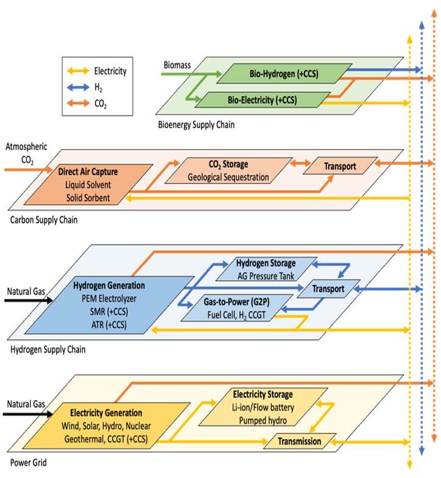

### One graph for every sector

Macro represents all of this as **one graph**. Each supply chain becomes a network of **nodes**, one per commodity and zone (the circles below), and **assets** are the boxes that connect the networks:

- a **gas plant with CCS** takes gas from the natural-gas network and delivers electricity to the grid, captured CO₂ to the CO₂ pipeline network, and its residual emissions to the CO₂ sink (the atmosphere);
- an **electrolyzer** links the grid to the hydrogen network;
- **direct air capture** uses electricity to take CO₂ out of the atmosphere and deliver it to the captured-CO₂ network.

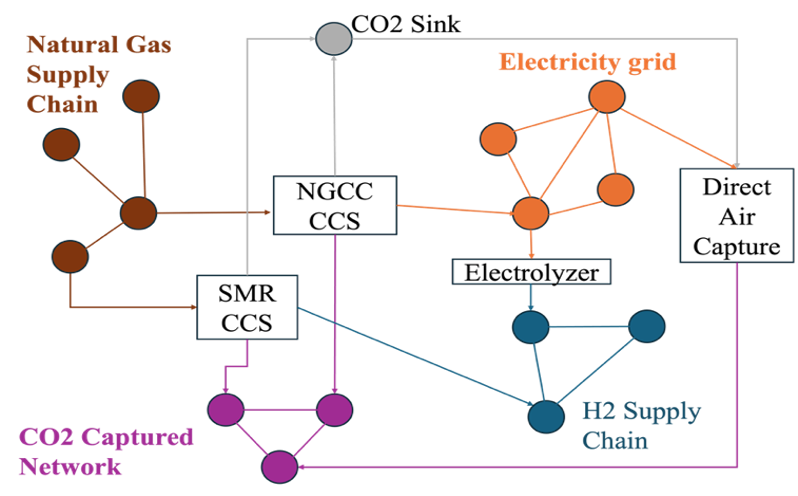

### Building blocks

In this case, those networks are the nodes listed in section 1: `elec_SE`, `elec_MIDAT` and `elec_NE` for the grid, `h2_*` for hydrogen, `natgas_*` for gas, `co2_captured_*` plus the `co2_storage_*` sites for captured CO₂, and `co2_sink` for the atmosphere.

As seen in the [introduction](https://github.com/macroenergy/MacroEnergyExamples.jl/blob/main/tutorials/slides/macro_workshop_intro.pdf), each of these nodes is connected by edges that represent the flow of commodities. Each asset is represented as a "box", a set of edges, transformations and storage, that connects the nodes together and represents the physical and operational characteristics of a technology. 

Inside each asset, the pieces are always the same few building blocks:

| Block | What it does |
|:---|:---|
| **Edge** | carries a single commodity |
| **Transformation** | converts commodities into each other, through balance equations |
| **Storage** | holds a commodity over time |

Let's, for example, look at two assets present in the system: a gas plant and an autothermal reforming (ATR) plant. The gas plant takes natural gas from the `natgas_SE` node, burns it to produce electricity for the `elec_SE` node, and emits CO₂ to the `co2_sink`. The ATR plant takes natural gas from the `natgas_SE` node, electricity from the `elec_SE` node and converts it into hydrogen for the `h2_SE` node, and also captures some of the CO₂ emissions to send to the `co2_captured_SE` node, while the rest is emitted to the `co2_sink`.

`load_case` reads the input files and builds this graph as a `System`. Loading also writes a few helper files next to the inputs, so this works on its own copy of the case (`runs/inspect`); section 3 makes the copy it solves.

```julia
inspect_dir = fresh_copy("inspect")   # loading writes helper files next to the inputs, so load a copy
case = load_case(inspect_dir)
system = case.systems[1]

println(length(system.assets), " assets, ", count(n -> n isa Node, system.locations), " nodes, ",
        length(system.commodities), " commodities")
sort!(combine(groupby(DataFrame(asset_type = [string(nameof(typeof(a))) for a in system.assets]), :asset_type), nrow => :count),
      :count, rev = true)
```

```
215 assets, 66 nodes, 17 commodities
23×2 DataFrame
 Row │ asset_type            count
─────┼─────────────────────────────
   1 │ VRE                      50
   2 │ ThermalPower             39
   3 │ BECCSLiquidFuels         12
   4 │ BECCSNaturalGas          12
   5 │ CO2Injection             12
   6 │ DownstreamEmissions      12
   7 │ UpstreamEmissions        12
   8 │ GasStorage                7
   9 │ BECCSElectricity          6
  10 │ BECCSGasoline             6
  11 │ BECCSHydrogen             6
  12 │ Battery                   6
  13 │ ThermalHydrogenCCS        6
  14 │ ElectricDAC               3
  15 │ Electrolyzer              3
  16 │ HydroRes                  3
  17 │ MustRun                   3
  18 │ NaturalGasDAC             3
  19 │ ThermalHydrogen           3
  20 │ ThermalPowerCCS           3
  21 │ SyntheticLiquidFuels      3
  22 │ SyntheticNaturalGas       3
  23 │ TransmissionLink          2
```

### Asset close-up: a gas power plant

Starting with the simplest asset: a natural-gas combined-cycle power plant. Every asset type can draw itself: `mermaid_diagram` returns a Mermaid flowchart of the type, with its transformation (the hexagon) and the edges that connect it to nodes. The fuel appears as a generic `Commodity` because the type works with any fuel.

!!! note
    In a notebook, the diagram renders inline in JupyterLab ≥ 4.1; elsewhere, paste the text into [mermaid.live](https://mermaid.live).

```julia
display("text/markdown", mermaid_diagram(ThermalPower))
```

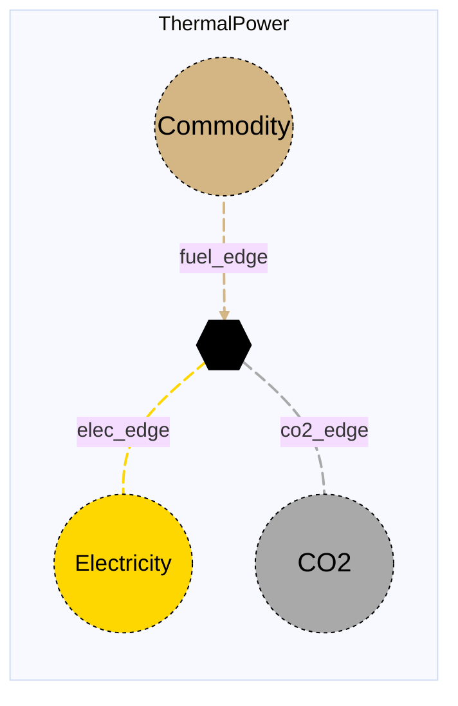

#### From CSV row to graph

The existing combined-cycle fleet in SE, `SE_natural_gas_fired_combined_cycle_1`, is one instance of this type, burning natural gas. Its CSV row became **one transformation and three edges**: gas in from the SE hub, electricity out to the SE grid, and CO₂ out to the atmosphere.

!!! details "Show the code"
    ```julia
    "The transformation at the core of an asset."
    core(asset) = only(getfield(asset, f) for f in fieldnames(typeof(asset)) if getfield(asset, f) isa ME.Transformation)

    "An asset's edges: the commodity each one carries and what it connects."
    function asset_edges(asset)
        edges = [(f, getfield(asset, f)) for f in fieldnames(typeof(asset)) if getfield(asset, f) isa ME.AbstractEdge]
        DataFrame(edge = [string(f) for (f, _) in edges],
                  commodity = [string(ME.commodity_type(e)) for (_, e) in edges],
                  from = [string(ME.id(e.start_vertex)) for (_, e) in edges],
                  to = [string(ME.id(e.end_vertex)) for (_, e) in edges],
                  has_capacity = [ME.has_capacity(e) for (_, e) in edges])
    end

    ccgt = get_asset_by_id(system, :SE_natural_gas_fired_combined_cycle_1)
    asset_edges(ccgt)
    ```

```
3×5 DataFrame
 Row │ edge       commodity    from                                              to                                                has_capacity
─────┼──────────────────────────────────────────────────────────────────────────────────────────────────────────────────────────────────────────
   1 │ elec_edge  Electricity  SE_natural_gas_fired_combined_cycle_1_transforms  elec_SE                                                   true
   2 │ fuel_edge  NaturalGas   natgas_SE                                         SE_natural_gas_fired_combined_cycle_1_transforms         false
   3 │ co2_edge   CO2          SE_natural_gas_fired_combined_cycle_1_transforms  co2_sink                                                 false
```

#### Balance equations

Two balance equations tie the edge flows together at every hour:

- **`:energy`** comes from `fuel_consumption`, the heat rate (MWh of gas per MWh of electricity);
- **`:emissions`** comes from `emission_rate` (t CO₂ per MWh of gas).

!!! note
    Because this plant uses unit commitment (`uc = true`), Macro also adds start-up fuel to `:energy` when it builds the model (`startup_fuel_consumption × capacity_size` MWh of gas per start), which the stored equations below don't show.

!!! details "Show the code"
    ```julia
    "Print a balance equation of a vertex as the algebra the solver sees, over the flows of its edges."
    function show_balance(vertex, balance_id; strip_prefix = "")
        bd = ME.balance_data(vertex, balance_id)
        parts = map(enumerate(bd.terms)) do (i, term)
            # Stored flow coefficients carry the edge's direction at the vertex (+1 in, −1 out); the model applies
            # that direction again when it builds the constraint, so multiplying by it recovers the algebraic coefficient.
            c = term.var == :flow && term.obj isa ME.AbstractEdge ? ME.balance_term_incidence(vertex, term.obj) .* term.coeff : term.coeff
            name = "$(term.var)($(replace(string(ME.id(term.obj)), strip_prefix => "")))"
            c isa AbstractVector && return (i == 1 ? "" : "+ ") * "c(t) × $name"
            sign = c < 0 ? "− " : (i == 1 ? "" : "+ ")
            return "$(sign)$(round(abs(c); sigdigits = 4)) × $name"
        end
        sense = get(Dict(:eq => "=", :le => "≤", :ge => "≥"), bd.sense, string(bd.sense))
        println(rpad(":" * string(balance_id), 14), join(parts, "  "), "  $sense  ", bd.constant)
    end

    "Print every balance equation of an asset's core transformation."
    show_balances(asset) = foreach(b -> show_balance(core(asset), b; strip_prefix = string(asset.id) * "_"), ME.balance_ids(core(asset)))

    show_balances(ccgt)
    ```

```
:emissions    0.181 × flow(fuel_edge)  − 1.0 × flow(co2_edge)  =  0.0
:energy       1.0 × flow(fuel_edge)  − 2.132 × flow(elec_edge)  =  0.0
```

### Asset close-up: hydrogen from gas with CCS

A hydrogen plant using autothermal reforming (ATR) with carbon capture follows the same pattern with two more edges: it also **draws electricity**, and it sends most of its CO₂ to the **captured-CO₂ network** instead of the atmosphere.

```julia
display("text/markdown", mermaid_diagram(ThermalHydrogenCCS))
```

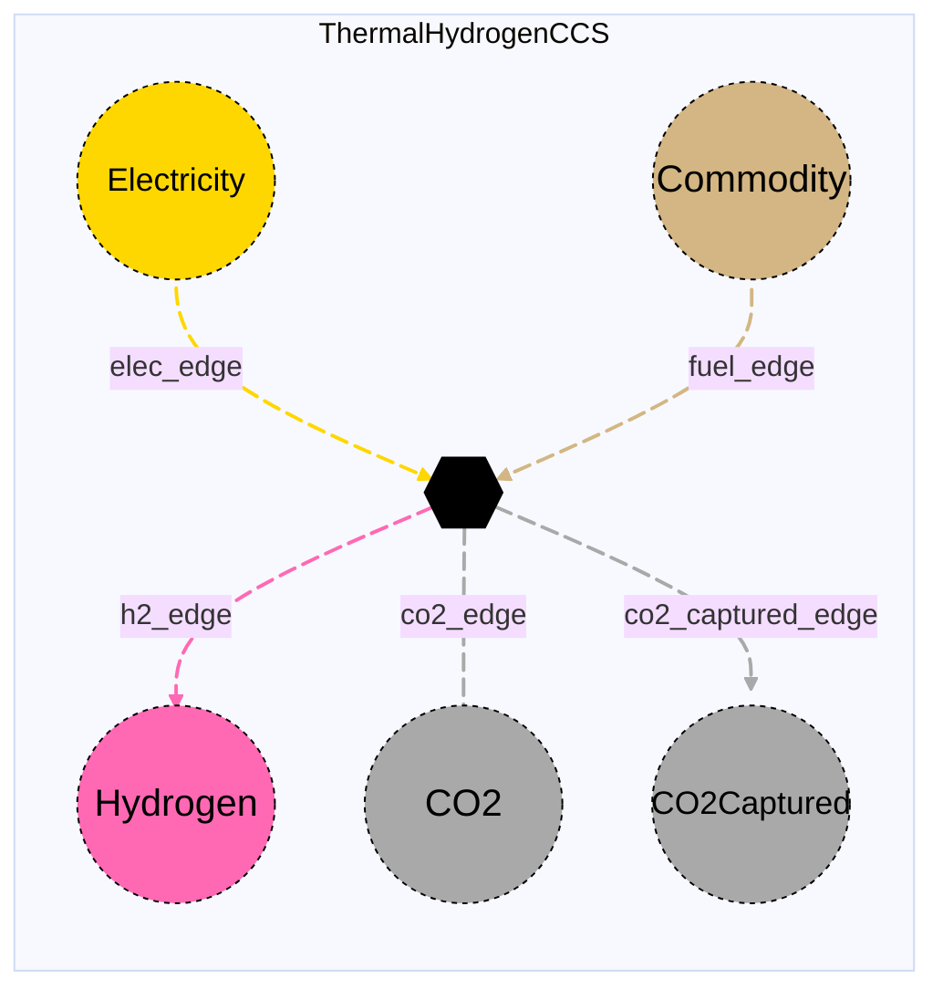

#### Five edges, four balance equations

The plant in the SE zone, `SE_ATR_wCCS_94pct`, is one instance of this type. Its CSV row became one transformation and five edges, each connected to a node:

```julia
atr = get_asset_by_id(system, :SE_ATR_wCCS_94pct)
asset_edges(atr)
```

```
5×5 DataFrame
 Row │ edge               commodity    from                          to                            has_capacity
─────┼──────────────────────────────────────────────────────────────────────────────────────────────────────────
   1 │ h2_edge            Hydrogen     SE_ATR_wCCS_94pct_transforms  h2_SE                                 true
   2 │ elec_edge          Electricity  elec_SE                       SE_ATR_wCCS_94pct_transforms         false
   3 │ fuel_edge          NaturalGas   natgas_SE                     SE_ATR_wCCS_94pct_transforms         false
   4 │ co2_edge           CO2          SE_ATR_wCCS_94pct_transforms  co2_sink                             false
   5 │ co2_captured_edge  CO2Captured  SE_ATR_wCCS_94pct_transforms  co2_captured_SE                      false
```

The flat CSV columns (`fuel_consumption`, `electricity_consumption`, `emission_rate`, `capture_rate`) became the coefficients of four balance equations that tie the edge flows together at every hour:

```julia
show_balances(atr)
```

```
:emissions    0.009958 × flow(fuel_edge)  − 1.0 × flow(co2_edge)  =  0.0
:energy       1.0 × flow(fuel_edge)  − 1.3 × flow(h2_edge)  =  0.0
:electricity  1.0 × flow(elec_edge)  − 0.1016 × flow(h2_edge)  =  0.0
:capture      0.1711 × flow(fuel_edge)  − 1.0 × flow(co2_captured_edge)  =  0.0
```

### Time-domain reduction

Instead of 8,760 hours, the case models **three representative weeks** (504 hours). Each week carries a weight: the number of calendar weeks it stands in for. Weights turn hourly results into annual totals, and every annualized number below uses them.

!!! details "Show the code"
    ```julia
    td = system.time_data[:Electricity]
    rep_weeks = td.subperiod_indices
    rep_weights = [td.subperiod_weights[w] for w in rep_weeks]
    println(DataFrame(representative_week = rep_weeks, hours = length.(td.subperiods), weeks_represented = round.(rep_weights; digits = 2)))

    calendar = sort(collect(td.subperiod_map), by = first)   # calendar week => representative week
    p = plot(; title = "Which representative week stands in for each calendar week", xlabel = "Calendar week",
             yaxis = false, yticks = false, grid = false, ylims = (0, 1.25), xlims = (0.5, length(calendar) + 0.5),
             xticks = 1:4:length(calendar), size = (900, 230))
    for (i, r) in enumerate(rep_weeks)
        weeks = [w for (w, rep) in calendar if rep == r]
        bar!(p, weeks, ones(length(weeks)); bar_width = 0.85, linewidth = 0, color = THREE[i],
             label = "Week $r (×$(fmt(rep_weights[i]; digits = 1)))")
    end
    scatter!(p, rep_weeks, fill(1.12, length(rep_weeks)); marker = :dtriangle, markersize = 6, color = INK,
             markerstrokewidth = 0, label = "the week itself")
    p
    ```

```
3×3 DataFrame
 Row │ representative_week  hours  weeks_represented
─────┼───────────────────────────────────────────────
   1 │                   7    168              23.06
   2 │                  18    168               9.02
   3 │                  33    168              20.05
```

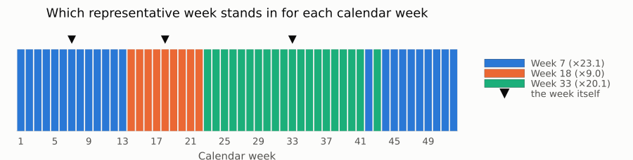

### (Advanced) Sub-commodities

**Sub-commodities** are more specific versions of a commodity. `commodities.json` declares them with `acts_like`:

```json
{"name": "Gasoline", "acts_like": "LiquidFuels"}
```

means *gasoline is a kind of liquid fuel*. Any technology that can handle liquid fuels can also handle gasoline, but gasoline gets its own nodes, so it's tracked separately from diesel or jet fuel.

!!! tip
    This case uses the same idea to keep fossil fuels apart. `Fossil_Gasoline` is also a liquid fuel, so the model can tell how much gasoline came from oil and how much was made from biomass or synthesis. Likewise, `Biomass_Wood` and `Biomass_Herb` are two kinds of biomass with their own prices and supply limits.

```julia
subs = [(c, T) for (c, T) in system.commodities if supertype(T) != ME.Commodity]
sort!(DataFrame(commodity = [string(c) for (c, _) in subs], acts_like = [string(nameof(supertype(T))) for (_, T) in subs]), :acts_like)
```

```
10×2 DataFrame
 Row │ commodity          acts_like
─────┼────────────────────────────────
   1 │ Biomass_Wood       Biomass
   2 │ Biomass_Herb       Biomass
   3 │ CO2Captured        CO2
   4 │ Diesel             LiquidFuels
   5 │ Gasoline           LiquidFuels
   6 │ Fossil_JetFuel     LiquidFuels
   7 │ JetFuel            LiquidFuels
   8 │ Fossil_Gasoline    LiquidFuels
   9 │ Fossil_Diesel      LiquidFuels
  10 │ Fossil_NaturalGas  NaturalGas
```

## 3. Solve

!!! tip
    `run_case` does everything in one call: load the case, build the JuMP model, solve, and write CSV results.

- **This run:** the case without its CO₂ cap. Section 5 adds the cap back.
- **Solver:** HiGHS, the open-source solver Macro uses by default. Any solver supported by JuMP can be passed as `optimizer`.
- **Options:** `optimizer_attributes` passes solver settings: the interior-point method followed by crossover, with the log silenced. Each of the two solves in this notebook takes a few minutes.

```julia
const HIGHS_OPTIONS = ("solver" => "ipm", "run_crossover" => "on", "ipm_optimality_tolerance" => 1e-3, "log_to_console" => false)

# Start from a fresh working copy of the case (helpers defined in the setup cells)
base_dir = prepare_case("base"; co2_cap = false)   # first run: no CO₂ cap (section 5 adds it)

t0 = time()
case, model = run_case(base_dir; optimizer = HiGHS.Optimizer, optimizer_attributes = HIGHS_OPTIONS, log_to_file = false)
println("run_case took ", round(time() - t0; digits = 1), " s")
system = case.systems[1];
```

### Did it solve?

Every run also writes `run_status.json` next to the case: a machine-readable verdict that's handy for batch runs on a cluster.

```julia
println("termination status: ", ME.JuMP.termination_status(model), "   primal status: ", ME.JuMP.primal_status(model))
println("objective:          ", round(ME.JuMP.objective_value(model); sigdigits = 5), " \$/yr")
print(read(joinpath(base_dir, "run_status.json"), String))
```

```
termination status: OPTIMAL   primal status: FEASIBLE_POINT
objective:          2.1293e11 $/yr
{
    "status": "OK",
    "case_path": "/path/to/tutorials/runs/base",
    "timestamp": "2026-11-04T11:11:08.778",
    "elapsed_seconds": 423.334,
    "output_path": "/path/to/tutorials/runs/base/results",
    "termination_status": "OPTIMAL"
}
```

## 4. What the model chose, with no climate policy

Every run writes the same set of long-format CSV files. `load_results` reads the ones used below and annualizes flows with the time weights (`annual = value × weight`, since the time step is 1 hour).

!!! details "Show the code"
    ```julia
    "Read the CSV outputs of a solved case and annualize flows with the time weights."
    function load_results(dir)
        out = joinpath(dir, "results", "results")
        rd(f) = CSV.read(joinpath(out, f), DataFrame)
        tw = rd("time_weights.csv")
        @assert tw.time == 1:nrow(tw)
        flows = rd("flows.csv")
        flows.annual = flows.value .* tw.weight[flows.time]
        return (; dir = out, weights = tw.weight, flows,
                  capacity = rd("capacity.csv"),
                  prices = rd("balance_duals.csv"),   # one column per node, one row per time step
                  co2 = isfile(joinpath(out, "co2_cap_duals.csv")) ? rd("co2_cap_duals.csv") : nothing,   # written only when there is a cap
                  costs = rd("costs.csv"),
                  costs_by_type = rd("costs_by_type.csv"))
    end

    base = load_results(base_dir)
    filter(endswith(".csv"), readdir(base.dir))
    ```

```
15-element Vector{String}:
 "balance_duals.csv"
 "capacity.csv"
 "capex.csv"
 "costs.csv"
 "costs_by_type.csv"
 "costs_by_zone.csv"
 "curtailment.csv"
 "flows.csv"
 "non_served_demand.csv"
 "objective_value.csv"
 "storage_level.csv"
 "time_weights.csv"
 "undiscounted_costs.csv"
 "undiscounted_costs_by_type.csv"
 "undiscounted_costs_by_zone.csv"
```

### Headline numbers

!!! details "Show the code"
    ```julia
    const ELEC_NODES = ["elec_" * z for z in ZONES]
    const H2_NODES   = ["h2_" * z for z in ZONES]

    "Group an electricity-producing component into one of TECH_ORDER."
    function tech_group(resource_type, resource_id)
        rt, id = String(resource_type), lowercase(String(resource_id))
        startswith(rt, "VRE")                                             && return occursin("wind", id) ? "Wind" : "Solar"
        rt == "ThermalPower{Uranium}"                                     && return "Nuclear"
        rt in ("ThermalPower{NaturalGas}", "ThermalPowerCCS{NaturalGas}") && return "Natural gas"
        rt == "ThermalPower{Hydrogen}"                                    && return "H₂ turbines"
        rt in ("HydroRes", "MustRun")                                     && return "Hydro"   # MustRun here is small hydro
        rt == "Battery"                                                   && return "Battery"
        return "Other"                                                    # power co-produced by bioenergy and DAC plants
    end

    "Annual end-use demand (from the input time series) summed over the given nodes."
    annual_demand(system, weights, node_ids) =
        sum(sum(ME.demand(n) .* weights) for n in system.locations if n isa Node && string(ME.id(n)) in node_ids)

    "Time-weighted average of the hourly prices (balance duals) over the given nodes."
    avg_price(res, node_ids) = sum(sum(res.prices[!, n] .* res.weights) for n in node_ids) / (sum(res.weights) * length(node_ids))

    "Net flow into the atmosphere (the `co2_sink` node), t/yr: emissions minus removals."
    net_emissions(res) = sum(res.flows.annual[(res.flows.node_in .== "co2_sink") .| (res.flows.node_out .== "co2_sink")])

    objective(res) = only(filter(r -> r.variable == "DiscountedTotalCost", res.costs).value)
    co2_penalty_paid(res) = sum(r.value for r in eachrow(res.costs_by_type) if r.type == "Total" && r.category == "UnmetPolicyPenalty"; init = 0.0)

    "Headline numbers of a solved case."
    function headline(res)
        elec = filter(r -> r.commodity == "Electricity" && startswith(r.component_type, r"(Unidirectional)?Edge"), res.capacity)
        gw(group, var) = sum(r.value for r in eachrow(elec) if r.variable == var && tech_group(r.resource_type, r.resource_id) == group; init = 0.0) / 1e3
        stored = sum(res.flows.annual[(res.flows.resource_type .== "CO2Injection") .& (res.flows.value .> 0)]; init = 0.0)
        DataFrame(metric = ["Objective (system cost + CO₂ penalty)", "System cost (excl. CO₂ penalty)", "CO₂ penalty paid",
                            "CO₂ price (shadow price of the cap)", "Net CO₂ emissions", "CO₂ into geologic storage",
                            "Avg. electricity price", "Avg. hydrogen price",
                            "New solar + wind", "New nuclear", "Retired natural-gas power"],
                  value = [objective(res) / 1e9, (objective(res) - co2_penalty_paid(res)) / 1e9, co2_penalty_paid(res) / 1e9,
                           (isnothing(res.co2) ? 0.0 : only(res.co2.CO2_Shadow_Price)), net_emissions(res) / 1e6, stored / 1e6,
                           avg_price(res, ELEC_NODES), avg_price(res, H2_NODES),
                           gw("Solar", "new_capacity") + gw("Wind", "new_capacity"), gw("Nuclear", "new_capacity"),
                           gw("Natural gas", "retired_capacity")],
                  unit = ["\$B/yr", "\$B/yr", "\$B/yr", "\$/t", "Mt/yr", "Mt/yr", "\$/MWh", "\$/MWh-H₂", "GW", "GW", "GW"])
    end

    base_headline = headline(base)
    transform(base_headline, :value => ByRow(v -> round(v; sigdigits = 4)) => :value)
    ```

```
11×3 DataFrame
 Row │ metric                                 value        unit
─────┼──────────────────────────────────────────────────────────────
   1 │ Objective (system cost + CO₂ penalty)  212.9        $B/yr
   2 │ System cost (excl. CO₂ penalty)        212.9        $B/yr
   3 │ CO₂ penalty paid                         0.0        $B/yr
   4 │ CO₂ price (shadow price of the cap)      0.0        $/t
   5 │ Net CO₂ emissions                      684.7        Mt/yr
   6 │ CO₂ into geologic storage                4.259e-16  Mt/yr
   7 │ Avg. electricity price                  32.94       $/MWh
   8 │ Avg. hydrogen price                     25.57       $/MWh-H₂
   9 │ New solar + wind                       387.6        GW
  10 │ New nuclear                              0.0        GW
  11 │ Retired natural-gas power               17.48       GW
```

### Reading the headline

*No CO₂ cap and no carbon price: the cheapest system on cost alone.*

!!! tip
    **Net emissions: 685 Mt/yr.** Nothing is captured, and hydrogen comes from unabated natural gas.

- **Wind and solar still win on cost:** about 390 GW of new wind and solar, with no policy pushing them.
- **Gas stays the backbone:** 192 of 210 GW of gas plants are kept.
- **Nuclear shrinks:** 41 of 62 GW of existing plants retire, and none is built.

### Electricity capacity: what's kept, retired and built

Capacity of electricity-producing components by technology group. The **grey** bar is capacity that existed before the optimization, and the **colored** bar is the optimal fleet.

!!! note
    The existing "Battery" capacity is pumped hydro, which Macro models with its `Battery` asset. For batteries this is discharge power; storage energy (MWh) is sized separately.

!!! details "Show the code"
    ```julia
    "Existing and optimal capacity (GW) of electricity-producing components, by technology group."
    function capacity_by_tech(res)
        c = filter(r -> r.commodity == "Electricity" && startswith(r.component_type, r"(Unidirectional)?Edge") &&
                        !endswith(r.component_id, "_charge_edge"), res.capacity)
        c.group = tech_group.(c.resource_type, c.resource_id)
        wide = unstack(combine(groupby(c, [:group, :variable]), :value => (v -> sum(v) / 1e3) => :GW), :variable, :GW)
        return sort!(wide, order(:group, by = g -> findfirst(==(g), TECH_ORDER)))
    end

    cap_base = capacity_by_tech(base)
    println(select(cap_base, :group, :existing_capacity, :retired_capacity, :new_capacity, :capacity))

    hbar_pair(cap_base.group, cap_base.existing_capacity, cap_base.capacity;
              colors = [TECH_COLORS[g] for g in cap_base.group], ref_label = "Existing", label = "Optimal (colored by technology)",
              unit = " GW", title = "Electricity capacity by technology, GW")
    ```

```
7×5 DataFrame
 Row │ group        existing_capacity  retired_capacity  new_capacity  capacity
─────┼──────────────────────────────────────────────────────────────────────────
   1 │ Nuclear                61.5709           40.8649         0.0     20.706
   2 │ Hydro                  38.6654            0.0            0.0     38.6654
   3 │ Natural gas           209.685            17.4826         0.0    192.202
   4 │ Wind                    6.8861            0.0          271.052  277.938
   5 │ H₂ turbines             0.0               0.0            0.0      0.0
   6 │ Solar                  13.1064            0.0          116.576  129.683
   7 │ Battery                14.7129            0.0            0.0     14.7129
```

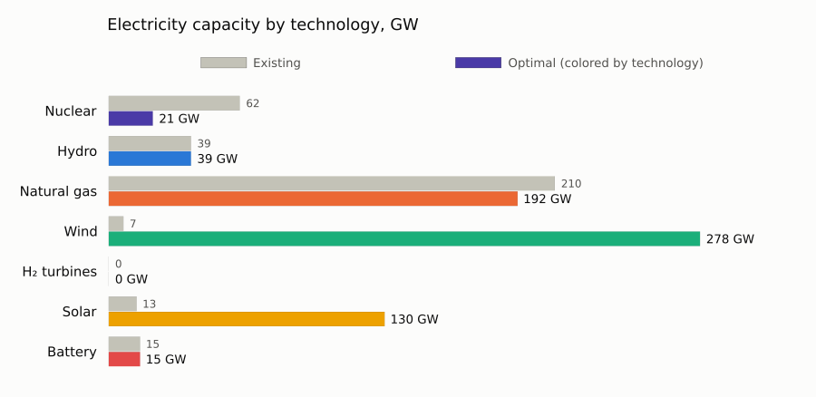

### Sector coupling: where electricity comes from and where it goes

Annual electricity supply by technology (left) and use (right), all zones combined, on one shared scale.

- **End-use demand** is the input demand time series. Any other use is load from other sectors: electrolyzers, direct air capture, fuel synthesis.
- **Without a cap there's almost none:** hydrogen comes from gas, so the other sectors barely draw on the grid. Section 5 shows how that changes.
- Transmission between zones is excluded, and supply exceeds use by storage and transmission losses.

!!! details "Show the code"
    ```julia
    "Annual flows (TWh or Mt) into and out of a set of nodes, excluding flows between those nodes."
    function sources_and_uses(res, nodes, source_label, use_label)
        f = res.flows
        into  = in(nodes).(f.node_out) .& .!in(nodes).(f.node_in)
        outof = in(nodes).(f.node_in) .& .!in(nodes).(f.node_out)
        src, use = f[into, :], f[outof, :]
        src.label = source_label.(src.resource_type, src.resource_id)
        use.label = use_label.(use.resource_type, use.resource_id)
        src, use = filter(r -> !isnothing(r.label), src), filter(r -> !isnothing(r.label), use)
        sources = combine(groupby(src, :label), :annual => (x -> sum(max.(x, 0)) / 1e6) => :annual)
        uses    = combine(groupby(use, :label), :annual => (x -> sum(max.(-x, 0)) / 1e6) => :annual)
        return filter(r -> r.annual > 0.5, sources), filter(r -> r.annual > 0.5, uses)   # hide flows below 0.5 TWh (or Mt) per year
    end

    function elec_use(rt, id)
        base = first(split(String(rt), '{'))
        base == "Electrolyzer"         && return "Electrolysis"
        base == "ElectricDAC"          && return "Direct air capture"
        base == "SyntheticNaturalGas"  && return "Synthetic methane"
        base == "SyntheticLiquidFuels" && return "Synthetic liquid fuels"
        base == "ThermalHydrogenCCS"   && return "H₂ from gas + CCS"
        base == "Battery"              && return "Battery charging"
        base == "GasStorage"           && return "H₂ storage & pipelines"
        startswith(base, "BECCS")      && return "Bioenergy + CCS"
        return "Other"
    end

    elec_src, elec_uses = sources_and_uses(base, ELEC_NODES, tech_group, elec_use)
    push!(elec_uses, ("End-use demand", annual_demand(system, base.weights, ELEC_NODES) / 1e6))

    xmax, rows = maximum(vcat(elec_src.annual, elec_uses.annual)), max(nrow(elec_src), nrow(elec_uses))
    p1 = hbar(elec_src.label, elec_src.annual; colors = [TECH_COLORS[l] for l in elec_src.label], title = "Supply, TWh/yr", xmax, rows)
    p2 = hbar(elec_uses.label, elec_uses.annual; title = "Use, TWh/yr", xmax, rows)
    plot(p1, p2; layout = (1, 2), size = (1100, 80 + 30 * rows))
    ```

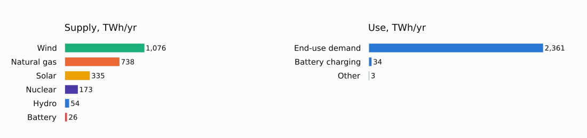

### An hour-by-hour look

One representative week in one zone. The stack is electricity delivered into the zone's grid by technology (imports excluded), and the black line is end-use demand. Wind and gas do most of the work, with gas flexing down when the sun is up; supply above the demand line is exported or stored.

!!! tip "Try it"
    change `ZONE` and `REP` in the cell below to explore other zones and weeks.

!!! details "Show the code"
    ```julia
    ZONE, REP = "SE", 1        # REP ∈ 1:3 indexes the representative weeks shown above (3 = the summer week)

    function dispatch_plot(res, system; zone = ZONE, rep = REP, hours_per_week = 168)
        node = "elec_" * zone
        hours = (rep - 1) * hours_per_week + 1 : rep * hours_per_week
        f = res.flows
        sel = (f.node_out .== node) .& .!in(ELEC_NODES).(f.node_in) .& in(hours).(f.time)
        gen = combine(groupby(transform(f[sel, :], [:resource_type, :resource_id] => ByRow(tech_group) => :group), [:group, :time]),
                      :value => (v -> sum(max.(v, 0)) / 1e3) => :GW)
        M = zeros(length(hours), length(TECH_ORDER))
        for r in eachrow(gen)
            M[r.time - first(hours) + 1, findfirst(==(r.group), TECH_ORDER)] += r.GW
        end
        x = 0:length(hours) - 1
        top = cumsum(M; dims = 2)

        # plot_title: the panels get no blank-title band of their own; the combined figure gets one (see the end)
        p1 = plot(; plot_title = "", ylabel = "GW", title = "$zone, representative week $(rep_weeks[rep]): electricity supply")
        for j in reverse(eachindex(TECH_ORDER))        # draw the top layer first so the legend reads top → bottom
            maximum(M[:, j]) > 0.5 || continue            # skip groups that never exceed 0.5 GW this week
            plot!(p1, x, top[:, j]; fillrange = j == 1 ? 0 : top[:, j - 1], fillalpha = 1, linewidth = 0.5,
                  linecolor = SURFACE, color = TECH_COLORS[TECH_ORDER[j]], label = TECH_ORDER[j])
        end
        node_obj = only(n for n in system.locations if n isa Node && string(ME.id(n)) == node)
        plot!(p1, x, ME.demand(node_obj)[hours] ./ 1e3; color = INK, linewidth = 2, label = "End-use demand")

        elz = f[(f.node_in .== node) .& (f.resource_type .== "Electrolyzer") .& in(hours).(f.time), :]
        elz_load = combine(groupby(elz, :time), :value => (v -> -sum(v) / 1e3) => :GW)
        p2 = plot(elz_load.time .- first(hours), elz_load.GW; plot_title = "", fillrange = 0, fillalpha = 0.25, color = NEUTRAL,
                  legend = false, ylabel = "GW", title = "Electrolyzer load")
        p3 = plot(x, res.prices[hours, node]; plot_title = "", color = NEUTRAL, linewidth = 1.5, legend = false,
                  ylabel = "\$/MWh", title = "Electricity price (balance dual)")
        ticks = (12:24:length(hours), ["Day $d" for d in 1:length(hours) ÷ 24])
        if isempty(elz_load.GW) || maximum(elz_load.GW) < 0.5          # no electrolyzers running this week: skip their panel
            return plot(p1, p3; plot_title = " ", layout = grid(2, 1; heights = [0.67, 0.33]), link = :x, xticks = ticks,
                        size = (950, 570), left_margin = 6Plots.mm)
        end
        plot(p1, p2, p3; plot_title = " ", layout = grid(3, 1; heights = [0.5, 0.25, 0.25]), link = :x, xticks = ticks,
             size = (950, 760), left_margin = 6Plots.mm)
    end

    dispatch_plot(base, system)
    ```

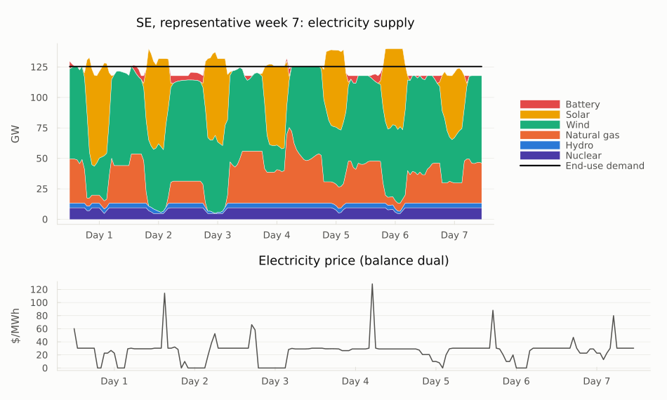

### Prices: duration curves

Back to the markets: every node clears every hour, and the price it clears at is its balance dual, the marginal cost of one more unit there. For electricity and hydrogen, these are **locational marginal prices**. Sorting each zone's hourly prices from highest to lowest, and stretching every hour by its time weight, gives a price-duration curve over the 8,760 hours of the year.

!!! details "Show the code"
    ```julia
    "Price-duration curve: prices sorted high → low against cumulative hours of the year."
    function duration_curve(prices, weights)
        o = sortperm(prices; rev = true)
        return vcat(0, cumsum(weights[o])), vcat(prices[o], prices[o][end])
    end

    function price_duration_plot(res, prefix, title, unit; ymax = nothing)
        p = plot(; title, xlabel = "Hours of the year", ylabel = unit, xlims = (0, 8760), legend = :topright)
        for z in ZONES
            h, pr = duration_curve(res.prices[!, prefix * z], res.weights)
            plot!(p, h, pr; seriestype = :steppost, color = ZONE_COLORS[z], label = z)
        end
        isnothing(ymax) || plot!(p; ylims = (0, ymax))
        return p
    end

    nodes = vcat(ELEC_NODES, H2_NODES)
    price_stats = DataFrame(node = nodes,
                            mean = [sum(base.prices[!, n] .* base.weights) / sum(base.weights) for n in nodes],
                            min = [minimum(base.prices[!, n]) for n in nodes],
                            max = [maximum(base.prices[!, n]) for n in nodes])
    println(transform(price_stats, Not(:node) .=> ByRow(v -> round(v; digits = 1)); renamecols = false))

    plot(price_duration_plot(base, "elec_", "Electricity (y-axis cut at \$300; maxima in the table)", "\$/MWh"; ymax = 300),
         price_duration_plot(base, "h2_", "Hydrogen", "\$/MWh-H₂"); layout = (1, 2), size = (1050, 400))
    ```

```
6×4 DataFrame
 Row │ node        mean     min      max
─────┼───────────────────────────────────────
   1 │ elec_SE        32.3     -0.0    300.4
   2 │ elec_MIDAT     31.1     -0.0    285.7
   3 │ elec_NE        35.5     -0.0    708.8
   4 │ h2_SE          24.6     21.1     31.2
   5 │ h2_MIDAT       24.2     18.6     31.1
   6 │ h2_NE          27.9     21.9     44.1
```

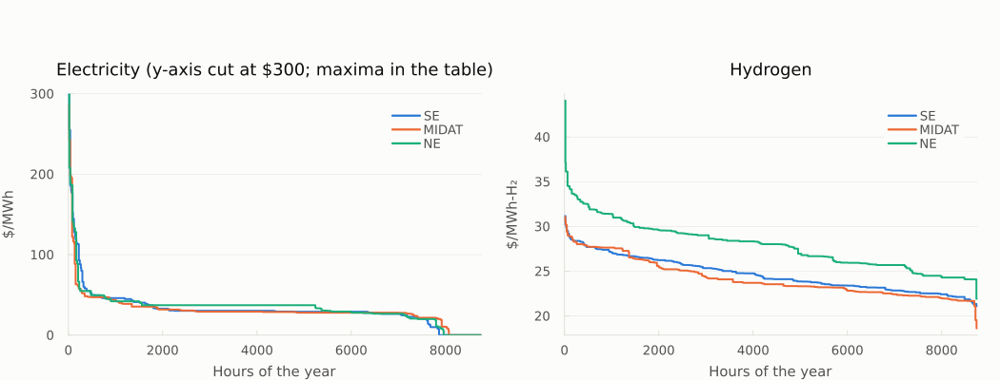

### What electricity costs, and who pays what

Pricing every MWh withdrawn from the grid at its hourly nodal price gives the annual electricity bill:

```math
\text{cost} = \sum_{e,\,t} -\,\text{flow}_{e,t} \times \text{dual}_{n(e),t} \times \text{weight}_t
```

Here *e* ranges over the edges leaving the zone nodes (their flows are negative), and end-use demand is priced the same way. Dividing each use's bill by its energy gives the average price it pays.

!!! tip
    Loads that can pick their hours pay less: battery charging (here, all of it pumped hydro) pays about USD 17/MWh against a USD 33 average. Without a cap there's little such flexible load; section 5 adds a lot of it.

!!! details "Show the code"
    ```julia
    "Annual cost of electricity withdrawn from the zone nodes at hourly nodal prices, by use (uses below `min_energy` MWh/yr dropped)."
    function electricity_bill(res, system; min_energy = 1e5)
        f = res.flows
        rows = f[in(ELEC_NODES).(f.node_in) .& .!in(ELEC_NODES).(f.node_out), :]
        price = Dict(n => res.prices[!, n] for n in ELEC_NODES)
        rows.cost   = -rows.value .* [price[n][t] for (n, t) in zip(rows.node_in, rows.time)] .* res.weights[rows.time]
        rows.energy = -rows.annual
        rows.use    = elec_use.(rows.resource_type, rows.resource_id)
        bill = combine(groupby(rows, :use), :cost => sum => :cost, :energy => sum => :energy)
        demand_cost, demand_energy = 0.0, 0.0
        for n in system.locations
            (n isa Node && string(ME.id(n)) in ELEC_NODES) || continue
            d = ME.demand(n)
            demand_cost   += sum(d .* price[string(ME.id(n))] .* res.weights)
            demand_energy += sum(d .* res.weights)
        end
        push!(bill, ("End-use demand", demand_cost, demand_energy))
        bill = filter(r -> r.energy > min_energy, bill)
        bill.avg_price = bill.cost ./ bill.energy
        return sort!(bill, :cost, rev = true)
    end

    "Total annual electricity cost, Σ −flow × dual × weight over all withdrawals (\$/yr)."
    electricity_cost(res, system) = sum(electricity_bill(res, system; min_energy = -Inf).cost)

    all_uses = electricity_bill(base, system; min_energy = -Inf)
    println("Total annual electricity cost: ", fmt(electricity_cost(base, system) / 1e9; digits = 1), " \$B/yr for ",
            fmt(sum(all_uses.energy) / 1e6), " TWh (", fmt(sum(all_uses.cost) / sum(all_uses.energy); digits = 1), " \$/MWh on average)")
    bill = electricity_bill(base, system)   # uses below 0.1 TWh/yr dropped from the table and charts
    println(transform(bill, :cost => ByRow(v -> round(v / 1e9; digits = 2)) => :cost_B,
                            :energy => ByRow(v -> round(v / 1e6; digits = 1)) => :TWh,
                            :avg_price => ByRow(v -> round(v; digits = 1)) => :avg_price)[:, [:use, :cost_B, :TWh, :avg_price]])

    avg_all = avg_price(base, ELEC_NODES)
    p1 = hbar(bill.use, bill.cost ./ 1e9; digits = 1, title = "Annual bill, \$B/yr")
    p2 = hbar(bill.use, bill.avg_price; digits = 1, title = "Average price paid, \$/MWh", ref = avg_all,
              ref_label = "time-weighted average $(fmt(avg_all; digits = 1))")
    plot(p1, p2; layout = (1, 2), size = (1100, 110 + 30 * nrow(bill)))
    ```

```
Total annual electricity cost: 77.3 $B/yr for 2,399 TWh (32.2 $/MWh on average)
3×4 DataFrame
 Row │ use               cost_B   TWh      avg_price
─────┼───────────────────────────────────────────────
   1 │ End-use demand      76.62   2361.2       32.4
   2 │ Battery charging     0.57     34.2       16.8
   3 │ Other                0.11      3.4       32.2
```

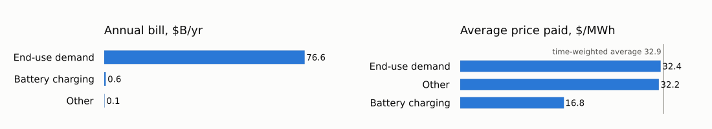

### What each technology earns per MWh

The same formula on the supply side gives the average price each technology earns per MWh it delivers, known in power markets as its *capture price*.

!!! tip
    Solar earns the least: it sells into the midday hours it floods itself. Batteries earn the most, selling into the few scarce hours.

!!! details "Show the code"
    ```julia
    "Average price earned per MWh delivered to the zone nodes, by technology group."
    function capture_prices(res)
        f = res.flows
        rows = f[in(ELEC_NODES).(f.node_out) .& .!in(ELEC_NODES).(f.node_in) .& (f.value .> 0), :]
        price = Dict(n => res.prices[!, n] for n in ELEC_NODES)
        rows.revenue = rows.value .* [price[n][t] for (n, t) in zip(rows.node_out, rows.time)] .* res.weights[rows.time]
        rows.group = tech_group.(rows.resource_type, rows.resource_id)
        cp = combine(groupby(rows, :group), :revenue => sum => :revenue, :annual => sum => :energy)
        cp = filter(r -> r.energy > 1e5, cp)                 # drop groups below 0.1 TWh/yr
        cp.capture_price = cp.revenue ./ cp.energy
        return cp
    end

    cp_base = capture_prices(base)
    hbar(cp_base.group, cp_base.capture_price; colors = [TECH_COLORS[g] for g in cp_base.group], digits = 1, ref = avg_all,
         ref_label = "time-weighted average $(fmt(avg_all; digits = 1))",
         title = "Average price earned per MWh delivered, \$/MWh")
    ```

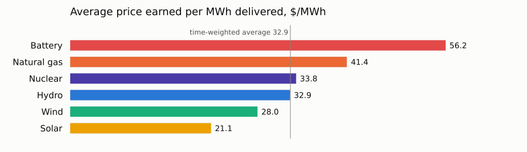

### Prices by hour of day

Prices by hour of day across the 21 modeled days. With gas setting the price in most hours, the range is narrow (colors are capped at the 95th percentile, about USD 50/MWh): midday solar pulls prices down in the winter and spring weeks, and summer evenings and nights are the most expensive.

!!! details "Show the code"
    ```julia
    "Heatmap of hourly electricity prices: hour of day × modeled day, one zone."
    function price_heatmap(res; zone = ZONE, clip_quantile = 0.95)
        p = res.prices[!, "elec_" * zone]
        ndays = length(p) ÷ 24
        M = reshape(p[1:24 * ndays], 24, ndays)
        cap = sort(p)[ceil(Int, clip_quantile * length(p))]
        ramp = cgrad(["#cde2fb", "#86b6ef", "#3987e5", "#1c5cab", "#0d366b"])   # one hue, light → dark
        h = heatmap(1:ndays, 0:23, min.(M, cap); color = ramp, clims = (0, cap), colorbar_title = "\$/MWh",
                    xlabel = "Modeled day", ylabel = "Hour of day", yticks = 0:3:21, yflip = true, grid = false,
                    xticks = (4:7:ndays, ["week $(w)" for w in rep_weeks]),
                    title = "$zone electricity price by hour (colors capped at the $(round(Int, 100 * clip_quantile))th percentile, $(fmt(cap)) \$/MWh)",
                    size = (950, 380))
        vline!(h, [7.5, 14.5]; color = SURFACE, linewidth = 3, label = false)   # separate the representative weeks
        return h
    end

    price_heatmap(base)
    ```

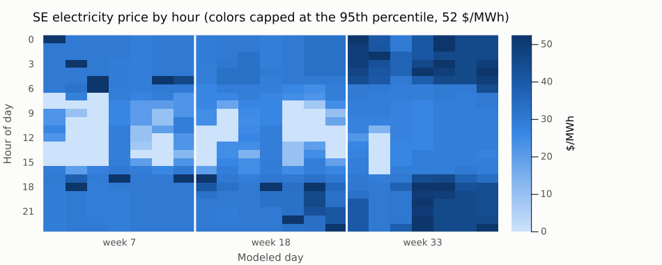

### Storage: state of charge

State of charge of each storage type, as a percentage of its own energy capacity, so very different sizes share one 0–100% scale. Levels are shown within each representative week, so each week is drawn separately.

!!! note
    H₂ pipelines are modeled as small storage assets and are left out, as is any storage with no energy-capacity limit, or less than 1 GWh of it.

!!! details "Show the code"
    ```julia
    "Aggregate state of charge (% of energy capacity) by storage type over the modeled hours."
    function storage_soc(res)
        sl = CSV.read(joinpath(res.dir, "storage_level.csv"), DataFrame)
        sl = filter(r -> !occursin("_to_", r.resource_id), sl)
        kind(rt) = startswith(rt, "Battery") ? "Battery" : startswith(rt, "HydroRes") ? "Hydro reservoirs" :
                   startswith(rt, "GasStorage") ? "H₂ storage" : rt
        sl.kind = kind.(sl.resource_type)
        cap = filter(r -> r.variable == "capacity" && occursin("Storage", r.component_type) && !occursin("_to_", r.resource_id), res.capacity)
        cap.kind = kind.(cap.resource_type)
        capk = combine(groupby(cap, :kind), :value => sum => :capacity)
        soc = combine(groupby(sl, [:kind, :time]), :value => sum => :level)
        soc = innerjoin(soc, capk, on = :kind)
        soc.pct = 100 .* soc.level ./ soc.capacity
        return soc, capk
    end

    soc, storage_caps = storage_soc(base)
    println(transform(storage_caps, :capacity => ByRow(v -> round(v / 1e3; digits = 1)) => :GWh)[:, [:kind, :GWh]])
    unlimited = storage_caps.kind[storage_caps.capacity .< 1e3]   # MWh: no energy-capacity limit, or under 1 GWh
    isempty(unlimited) || println("Left out (no energy-capacity limit, or under 1 GWh): ", join(unlimited, ", "))

    p = plot(; ylabel = "% of energy capacity", ylims = (0, 100), xlabel = "Modeled hour",
             xticks = (84:168:504, ["week $(w)" for w in rep_weeks]), size = (950, 360),
             title = "Storage state of charge (each type relative to its own energy capacity)")
    for (i, k) in enumerate(setdiff(storage_caps.kind, unlimited))
        s = sort(filter(r -> r.kind == k, soc), :time)
        for (j, week) in enumerate(td.subperiods)          # one segment per representative week
            w = filter(r -> r.time in week, s)
            plot!(p, w.time, w.pct; color = THREE[i], linewidth = 1.5, label = j == 1 ? k : false)
        end
    end
    vline!(p, [168.5, 336.5]; color = HAIRLINE, linewidth = 1, label = false)
    p
    ```

```
3×2 DataFrame
 Row │ kind              GWh
─────┼───────────────────────────
   1 │ Battery             228.0
   2 │ H₂ storage            0.0
   3 │ Hydro reservoirs      0.0
Left out (no energy-capacity limit, or under 1 GWh): H₂ storage, Hydro reservoirs
```

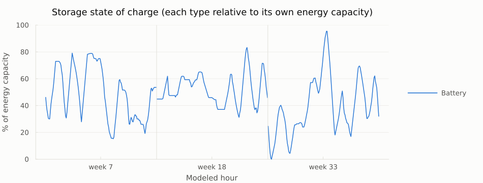

### Hydrogen: production pathways and uses

Annual hydrogen production (left) and use (right), all zones combined, on one shared scale.

!!! tip
    Without a cap, all hydrogen comes from unabated gas reforming (SMR), and it only serves direct hydrogen demand.

!!! details "Show the code"
    ```julia
    function h2_source(rt, id)
        base = first(split(String(rt), '{'))
        base == "Electrolyzer"       && return "Electrolysis"
        base == "ThermalHydrogenCCS" && return occursin("ATR", String(id)) ? "Gas ATR + CCS" : "Gas SMR + CCS"
        base == "ThermalHydrogen"    && return "Gas SMR (unabated)"
        base == "BECCSHydrogen"      && return "Biomass gasification + CCS"
        base == "GasStorage"         && return nothing       # storage and pipelines only move H₂
        return "Other"
    end
    function h2_use(rt, id)
        base = first(split(String(rt), '{'))
        base == "SyntheticNaturalGas"  && return "Synthetic methane"
        base == "SyntheticLiquidFuels" && return "Synthetic liquid fuels"
        base == "ThermalPower"         && return "H₂ turbines"
        base == "GasStorage"           && return nothing
        return "Other"
    end

    h2_src, h2_uses = sources_and_uses(base, H2_NODES, h2_source, h2_use)
    push!(h2_uses, ("End-use demand", annual_demand(system, base.weights, H2_NODES) / 1e6))
    xmax, rows = maximum(vcat(h2_src.annual, h2_uses.annual)), max(nrow(h2_src), nrow(h2_uses))
    plot(hbar(h2_src.label, h2_src.annual; title = "Production, TWh-H₂/yr", xmax, rows),
         hbar(h2_uses.label, h2_uses.annual; title = "Use, TWh-H₂/yr", xmax, rows);
         layout = (1, 2), size = (1100, 80 + 30 * rows))
    ```

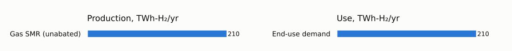

### [Costs](@id tutorial3-costs)

- `costs.csv` holds the objective, split into fixed and variable costs.
- `costs_by_type.csv` breaks costs down by asset type and category.

Without a cap, fuel and feedstock purchases (`Fuel`) are the largest cost.

```julia
breakdown = unstack(filter(r -> r.type == "Total", base.costs_by_type), :type, :value)
println("Objective:              ", round(objective(base) / 1e9; digits = 1), " \$B/yr")
select!(transform(breakdown, :Total => ByRow(v -> round(v / 1e9; digits = 2)) => "Total \$B/yr"), Not(:Total))
```

```
Objective:              212.9 $B/yr
6×2 DataFrame
 Row │ category    Total $B/yr
─────┼─────────────────────────
   1 │ VariableOM         9.06
   2 │ Fuel             137.69
   3 │ Investment        39.09
   4 │ FixedOM           26.33
   5 │ Startup            0.76
   6 │ Total            212.93
```

```julia
capital = filter(r -> r.category in ("Investment", "FixedOM") && r.type != "Total" && !startswith(r.type, "Node"), base.costs_by_type)
capital.group = capital.type   # e.g. ThermalPower{Uranium} is nuclear, ThermalPower{Hydrogen} is H₂ turbines
by_type = sort(combine(groupby(capital, :group), :value => (v -> sum(v) / 1e9) => :B), :B, rev = true)
top = first(by_type, 10)
nrow(by_type) > 10 && push!(top, ("Other ($(nrow(by_type) - 10) types)", sum(by_type.B[11:end])))
println("Total capital cost: ", fmt(sum(by_type.B); digits = 1), " \$B/yr")
hbar(top.group, top.B; digits = 1, title = "Capital cost (investment + fixed O&M) by asset type, \$B/yr")
```

```
Total capital cost: 65.4 $B/yr
```

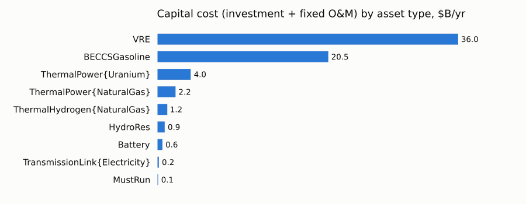

## 5. Scenario: adding the CO₂ cap

!!! tip
    With plain-file inputs, a scenario is a small edit.

So far the system had no climate policy. This run uses the case as shipped, with the CO₂ cap on the atmosphere node: zero net emissions, soft at USD 1,000 per tonne. That entry in `nodes.json` is the only difference from the first run:

```julia
cap_dir = prepare_case("co2_cap")      # the case as shipped: CO₂ cap on co2_sink
co2_sink_entry(dir) = only(n for b in ME.JSON3.read(read(joinpath(dir, "system", "nodes.json"), String)).nodes
                             for n in b.instance_data if n.id == "co2_sink")
println("First run (no cap):"); ME.JSON3.pretty(stdout, co2_sink_entry(base_dir))
println("\n\nThis run:");        ME.JSON3.pretty(stdout, co2_sink_entry(cap_dir))
```

```
First run (no cap):
{
    "constraints": {
        "BalanceConstraint": false,
        "CO2CapConstraint": false
    },
    "id": "co2_sink"
}

This run:
{
    "constraints": {
        "BalanceConstraint": false,
        "CO2CapConstraint": true
    },
    "id": "co2_sink",
    "rhs_policy": {
        "CO2CapConstraint": 0
    },
    "price_unmet_policy": {
        "CO2CapConstraint": 1000
    }
}
```

```julia
t0 = time()
case_cap, model_cap = run_case(cap_dir; optimizer = HiGHS.Optimizer, optimizer_attributes = HIGHS_OPTIONS, log_to_file = false)
println("run_case took ", round(time() - t0; digits = 1), " s; status ", ME.JuMP.termination_status(model_cap))
capped = load_results(cap_dir);
```

### No cap vs. cap

The headline numbers for both runs, plus the total electricity bill. The last column is what the cap changes:

```julia
with_bill(h, res, sys) = vcat(h, DataFrame(metric = "Total electricity cost", value = electricity_cost(res, sys) / 1e9, unit = "\$B/yr"))
cmp = innerjoin(rename(with_bill(base_headline, base, system), :value => :no_cap),
                select(rename(with_bill(headline(capped), capped, case_cap.systems[1]), :value => :co2_cap), Not(:unit)),
                on = :metric)
cmp.change = cmp.co2_cap .- cmp.no_cap
select!(cmp, :metric, :no_cap, :co2_cap, :change, :unit)
transform(cmp, [:no_cap, :co2_cap, :change] .=> ByRow(v -> round(v; sigdigits = 4)); renamecols = false)
```

```
12×5 DataFrame
 Row │ metric                                 no_cap       co2_cap  change   unit
─────┼────────────────────────────────────────────────────────────────────────────────
   1 │ Objective (system cost + CO₂ penalty)  212.9         491.9    279.0   $B/yr
   2 │ System cost (excl. CO₂ penalty)        212.9         308.0     95.09  $B/yr
   3 │ CO₂ penalty paid                         0.0         183.9    183.9   $B/yr
   4 │ CO₂ price (shadow price of the cap)      0.0        1000.0   1000.0   $/t
   5 │ Net CO₂ emissions                      684.7         183.9   -500.8   Mt/yr
   6 │ CO₂ into geologic storage                4.259e-16    40.76    40.76  Mt/yr
   7 │ Avg. electricity price                  32.94         55.55    22.61  $/MWh
   8 │ Avg. hydrogen price                     25.57         47.58    22.01  $/MWh-H₂
   9 │ New solar + wind                       387.6        1022.0    633.9   GW
  10 │ New nuclear                              0.0          70.91    70.91  GW
  11 │ Retired natural-gas power               17.48        195.7    178.3   GW
  12 │ Total electricity cost                  77.3         174.8     97.47  $B/yr
```

### What the cap changes

!!! tip
    **Emissions fall by 73%, from 685 to 184 Mt/yr.** Total cost rises from USD 213 to USD 492 billion a year: USD 95 billion more for the system itself, plus the USD 184 billion penalty on the emissions that remain.

- **Power is rebuilt:** about 425 GW more solar, 210 GW more wind and 110 GW more nuclear, while almost 180 GW of gas plants go.
- **The existing nuclear fleet stays:** without the cap, 41 of its 62 GW retire.
- **Electricity gets expensive:** the average price rises from USD 33 to USD 56/MWh, and the total electricity bill more than doubles, from USD 77 to USD 175 billion a year.

```julia
cap_co2 = capacity_by_tech(capped)
delta = outerjoin(select(cap_base, :group, :capacity => :no_cap), select(cap_co2, :group, :capacity => :co2_cap), on = :group)
delta.change = coalesce.(delta.co2_cap, 0.0) .- coalesce.(delta.no_cap, 0.0)
println(select(delta, :group, [:no_cap, :co2_cap, :change] .=> ByRow(v -> ismissing(v) ? v : round(v; digits = 1)); renamecols = false))
delta = filter(r -> abs(r.change) > 0.05, delta)
hbar(delta.group, delta.change; colors = [TECH_COLORS[g] for g in delta.group], digits = 1, unit = " GW",
     title = "Change in optimal electricity capacity with the CO₂ cap (vs. no cap), GW")
```

```
7×4 DataFrame
 Row │ group        no_cap   co2_cap  change
─────┼────────────────────────────────────────
   1 │ Nuclear         20.7    132.5    111.8
   2 │ Hydro           38.7     38.7      0.0
   3 │ Natural gas    192.2     14.8   -177.4
   4 │ Wind           277.9    486.2    208.2
   5 │ H₂ turbines      0.0     25.8     25.8
   6 │ Solar          129.7    555.4    425.7
   7 │ Battery         14.7     36.4     21.7
```

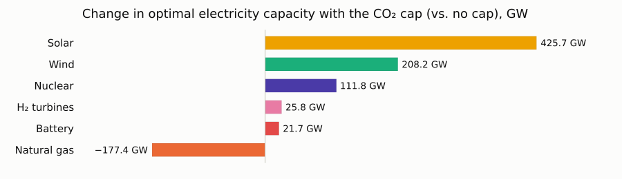

### The cap couples the sectors

Without a cap, electricity serves almost only ordinary demand. With the cap, electrolyzers appear, and hydrogen moves from gas to electricity:

!!! details "Show the code"
    ```julia
    "Annual electricity use by label (TWh/yr), end-use demand included."
    function electricity_uses(res, sys)
        uses = sources_and_uses(res, ELEC_NODES, tech_group, elec_use)[2]
        push!(uses, ("End-use demand", annual_demand(sys, res.weights, ELEC_NODES) / 1e6))
        return uses
    end

    u = outerjoin(rename(electricity_uses(base, system), :annual => :no_cap),
                  rename(electricity_uses(capped, case_cap.systems[1]), :annual => :co2_cap), on = :label)
    u.no_cap, u.co2_cap = coalesce.(u.no_cap, 0.0), coalesce.(u.co2_cap, 0.0)
    u = u[sortperm(u.co2_cap; rev = true), :]
    for (name, res) in (("No cap", base), ("CO₂ cap", capped))
        h2 = sort(sources_and_uses(res, H2_NODES, h2_source, h2_use)[1], :annual, rev = true)
        println(rpad(name, 9), "hydrogen from: ", join(["$(r.label) $(fmt(r.annual)) TWh" for r in eachrow(h2)], ", "))
    end
    hbar_pair(u.label, u.no_cap, u.co2_cap; colors = fill(BAR, nrow(u)), ref_label = "No cap", label = "CO₂ cap", unit = " TWh",
              title = "Electricity use, no cap vs. CO₂ cap, TWh/yr")
    ```

```
No cap   hydrogen from: Gas SMR (unabated) 210 TWh
CO₂ cap  hydrogen from: Electrolysis 1,153 TWh
```

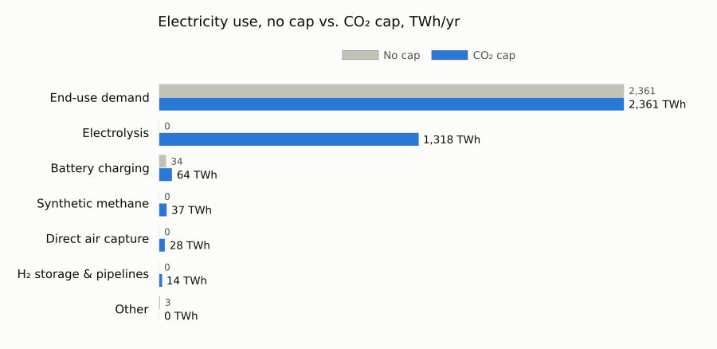

### The carbon balance

The case tracks two CO₂ commodities:

| Commodity | What it is | Goes in | Comes out |
|:---|:---|:---|:---|
| **`CO2`** | the atmosphere (`co2_sink`), where the cap applies | combustion | direct air capture (DAC) and bioenergy with CCS (BECCS) |
| **`CO2Captured`** | CO₂ in pipelines, after capture | capture plants | geologic storage (limited per site by `CO2StorageConstraint`) or synthetic fuels |

Annual CO₂ flows into (+) and out of (−) the atmosphere, without and with the cap:

!!! details "Show the code"
    ```julia
    const CO2_LABELS = Dict(
        "DownstreamEmissions{Gasoline}" => "Gasoline end use", "DownstreamEmissions{Diesel}" => "Diesel end use",
        "DownstreamEmissions{JetFuel}" => "Jet fuel end use", "DownstreamEmissions{NaturalGas}" => "Natural gas end use",
        "SyntheticNaturalGas" => "Synthetic methane plants", "SyntheticLiquidFuels" => "Synthetic liquid fuel plants",
        "ThermalPower{NaturalGas}" => "Gas power", "ThermalPowerCCS{NaturalGas}" => "Gas power + CCS",
        "ThermalHydrogen{NaturalGas}" => "H₂ from gas", "ThermalHydrogenCCS{NaturalGas}" => "H₂ from gas + CCS",
        "BECCSLiquidFuels" => "BECCS liquid fuels", "BECCSGasoline" => "BECCS gasoline", "BECCSHydrogen" => "BECCS hydrogen",
        "BECCSElectricity" => "BECCS power", "BECCSNaturalGas" => "BECCS methane",
        "ElectricDAC" => "DAC (electric)", "NaturalGasDAC" => "DAC (gas-fired)")

    "Net annual flow into the atmosphere by source (Mt/yr): positive = emission, negative = removal."
    function atmosphere_balance(res; min_mt = 0.5)
        f = res.flows[(res.flows.node_in .== "co2_sink") .| (res.flows.node_out .== "co2_sink"), :]
        f.label = [get(CO2_LABELS, rt, rt) for rt in f.resource_type]
        by = combine(groupby(f, :label), :annual => (x -> sum(x) / 1e6) => :Mt)
        small = abs.(by.Mt) .< min_mt
        any(small) && (by = vcat(by[.!small, :], DataFrame(label = "Other (< $(min_mt) Mt each)", Mt = sum(by.Mt[small]))))
        return by
    end

    for (name, res) in (("No cap", base), ("CO₂ cap", capped))
        by = atmosphere_balance(res)
        println(rpad(name, 9) * "emissions " * fmt(sum(filter(>(0), by.Mt); init = 0.0)) * " Mt, removals " *
                fmt(-sum(filter(<(0), by.Mt); init = 0.0)) * " Mt, net " * fmt(sum(by.Mt); digits = 1) * " Mt/yr")
    end

    # Both runs on the same rows: sources below 0.5 Mt/yr in both runs are grouped
    both = outerjoin(rename(atmosphere_balance(base; min_mt = 0), :Mt => :no_cap),
                     rename(atmosphere_balance(capped; min_mt = 0), :Mt => :co2_cap), on = :label)
    both.no_cap, both.co2_cap = coalesce.(both.no_cap, 0.0), coalesce.(both.co2_cap, 0.0)
    small = max.(abs.(both.no_cap), abs.(both.co2_cap)) .< 0.5
    any(small) && (both = vcat(both[.!small, :], DataFrame(label = "Other (< 0.5 Mt each)", no_cap = sum(both.no_cap[small]), co2_cap = sum(both.co2_cap[small]))))
    both = both[sortperm(both.no_cap .+ both.co2_cap; rev = true), :]
    hbar_pair(both.label, both.no_cap, both.co2_cap; colors = [v > 0 ? EMIT : REMOVE for v in both.co2_cap],
              ref_label = "No cap", label = "CO₂ cap (red: emission, blue: removal)", digits = 1, unit = " Mt",
              title = "Annual CO₂ flows into (+) and out of (−) the atmosphere, Mt/yr")
    ```

```
No cap   emissions 808 Mt, removals 123 Mt, net 684.7 Mt/yr
CO₂ cap  emissions 478 Mt, removals 294 Mt, net 183.9 Mt/yr
```

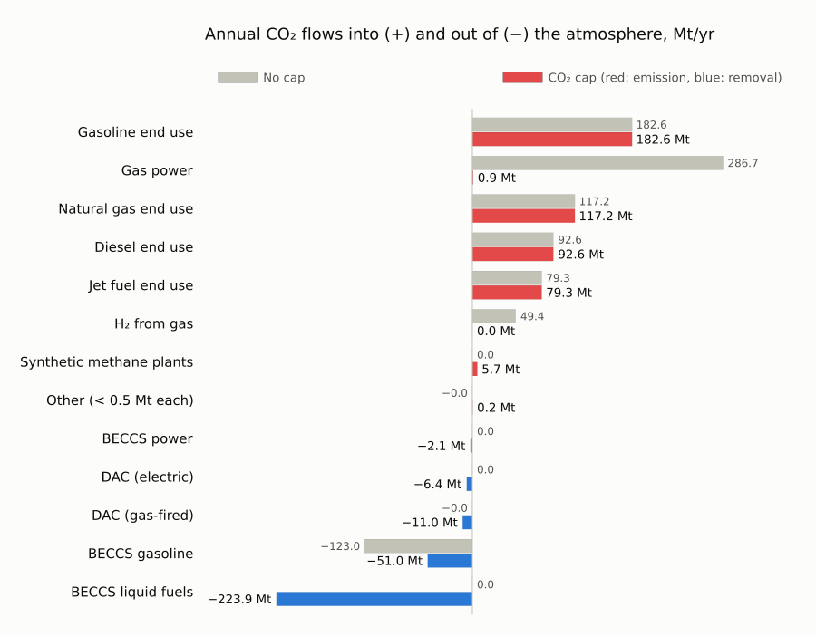

!!! tip
    Emissions from burning fuels don't change: fuel demand is fixed. The cap all but removes the emissions from gas power (287 → 1 Mt) and from hydrogen made from gas (49 → 0 Mt), and pays for removals: BECCS and direct air capture.

!!! note
    Even without the cap, some gasoline is made from biomass: the CO₂ its biomass absorbed shows up as a removal (123 Mt), and it's emitted again when that gasoline burns.

#### Captured CO₂: where it comes from and where it goes

Without the cap, nothing is captured. With it, about 170 Mt/yr is, mostly at BECCS fuel plants. Geologic storage is capped at 40.8 Mt/yr, so most captured CO₂ becomes synthetic methane instead, and the captured-CO₂ markets clear at a negative price (their balance dual): whoever brings captured CO₂ pays to get rid of it. It's a liability, not a resource.

!!! details "Show the code"
    ```julia
    "Where captured CO₂ comes from and where it goes (Mt/yr)."
    function captured_co2(res)
        f = res.flows[res.flows.commodity .== "CO2Captured", :]
        nodes = unique(filter(startswith("co2_captured_"), vcat(f.node_in, f.node_out)))
        captured = combine(groupby(f[in(nodes).(f.node_out) .& .!in(nodes).(f.node_in), :], :resource_type), :annual => (x -> sum(x) / 1e6) => :Mt)
        fate = combine(groupby(f[in(nodes).(f.node_in) .& .!in(nodes).(f.node_out), :], :resource_type), :annual => (x -> -sum(x) / 1e6) => :Mt)
        return (captured = sort!(filter(r -> r.Mt > 0.05, captured), :Mt, rev = true),
                fate = sort!(filter(r -> r.Mt > 0.05, fate), :Mt, rev = true))
    end

    cc = captured_co2(capped)
    storage_limit = sum(ME.rhs_policy(n)[CO2StorageConstraint] for n in case_cap.systems[1].locations
                        if n isa Node && haskey(ME.rhs_policy(n), CO2StorageConstraint))
    println("Captured without the cap: ", fmt(sum(captured_co2(base).captured.Mt; init = 0.0); digits = 1), " Mt/yr")
    println("Captured with the cap:    ", fmt(sum(cc.captured.Mt); digits = 1), " Mt/yr")
    println(cc.captured)
    println("\nDestination (CO2Injection = geologic storage; limit across all sites: ", fmt(storage_limit / 1e6; digits = 1), " Mt/yr)")
    println(cc.fate)
    println("\nMarginal value of captured CO₂ with the cap (balance dual), \$/t: ",
            join(["$z $(fmt(sum(capped.prices[!, "co2_captured_" * z] .* capped.weights) / sum(capped.weights)))" for z in ZONES], ", "))
    ```

```
Captured without the cap: 0.0 Mt/yr
Captured with the cap:    168.3 Mt/yr
5×2 DataFrame
 Row │ resource_type                Mt
─────┼─────────────────────────────────────────
   1 │ BECCSLiquidFuels             142.558
   2 │ NaturalGasDAC                 17.1546
   3 │ ElectricDAC                    6.37358
   4 │ BECCSElectricity               2.08959
   5 │ ThermalPowerCCS{NaturalGas}    0.107343

Destination (CO2Injection = geologic storage; limit across all sites: 40.8 Mt/yr)
3×2 DataFrame
 Row │ resource_type         Mt
─────┼──────────────────────────────────
   1 │ SyntheticNaturalGas   127.177
   2 │ CO2Injection           40.7641
   3 │ SyntheticLiquidFuels    0.342617

Marginal value of captured CO₂ with the cap (balance dual), $/t: SE −718, MIDAT −589, NE −515
```

### Who earns more with the cap

Prices rise in the hours when clean supply is scarce, so the technologies that can run then gain most. The average price nuclear earns per MWh roughly triples and batteries' more than doubles, while solar's barely moves:

```julia
cp_cmp = outerjoin(select(cp_base, :group, :capture_price => :no_cap), select(capture_prices(capped), :group, :capture_price => :co2_cap), on = :group)
cp_cmp = sort!(dropmissing(cp_cmp), order(:group, by = g -> findfirst(==(g), TECH_ORDER)))
hbar_pair(cp_cmp.group, cp_cmp.no_cap, cp_cmp.co2_cap; colors = [TECH_COLORS[g] for g in cp_cmp.group],
          ref_label = "No cap", label = "CO₂ cap (colored by technology)", digits = 1,
          title = "Average price earned per MWh, no cap vs. CO₂ cap, \$/MWh")
```

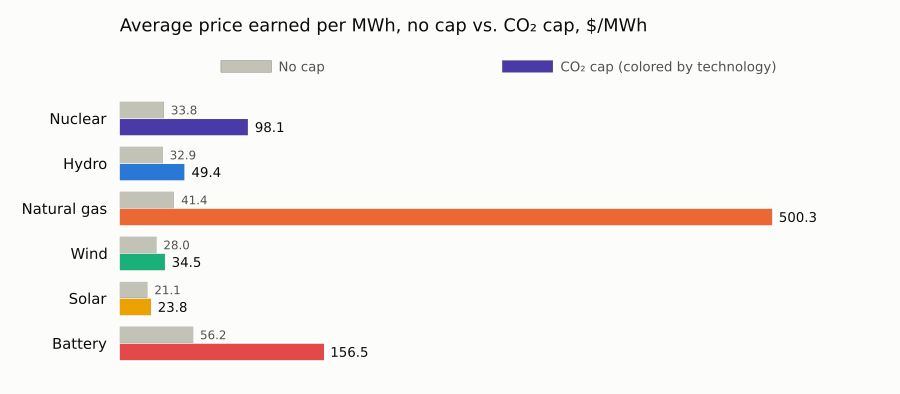

## How to read this case

This is a **stylized end state** for showing what Macro can do, not a forecast.

| Simplification | What it means | To relax it |
|:---|:---|:---|
| **One planning step** | The system is rebuilt in a single period, with no limits on how fast capacity can be built or on land use. | `"ExpansionHorizon": "Myopic"` with several periods gives a pathway instead. |
| **Fixed end-use demand** | Electricity (~2,360 TWh/yr) and the demand for gasoline, diesel, jet fuel and gas stay close to today's levels, with no electrification of transport or heat. All of the decarbonization falls on the supply side and on negative emissions. | Edit the demand time series in `system/`. |
| **Existing pumped hydro only** | Pumped-hydro plants keep their current power and 15.5 hours of storage (the default PowerGenome uses for existing plants); no new pumped hydro is built. | Edit `assets/electricity_stor.csv`. |
| **Three representative weeks** | Storage and renewable adequacy are only tested against 504 hours. | Swap in full-year time series and a matching `system/time_data.json`. |
| **A very high carbon price** (section 5) | USD 1,000/t is several times common estimates of the social cost of carbon. | Lower `CO2_PENALTY` (e.g. to 200). |

## Where to go next

All of these are keys in `settings/case_settings.json` (this case doesn't ship one, so it runs on the defaults), except the last row.

| To… | Use |
|:---|:---|
| **Decompose** planning from operations | `"SolutionAlgorithm": "Benders"`; subproblems can run in parallel (`Distributed`) |
| **Plan over several periods** | `"ExpansionHorizon": "Myopic"` solves one period at a time and carries capacity forward; `PerfectForesight` optimizes all periods jointly |
| **Get full-year outputs** | `"WriteFullTimeseries": true` expands representative-week results to all 8,760 hours |
| **Improve conditioning** | `"ParameterScaling": true` rescales costs and quantities before the solve and undoes it in the outputs |
| **Add your own technologies** | put asset definitions in `user_additions/` inside the case folder, and they're loaded with the case. No package changes needed. |
