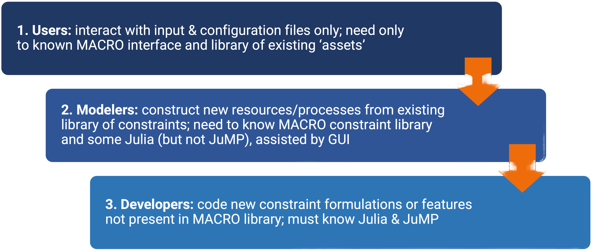

```@meta
CurrentModule = MacroEnergy
```

# Macro

**Welcome to the [Macro](https://github.com/macroenergy/MacroEnergy.jl.git) documentation!**

**This documentation is a work-in-progress, so please forgive our appearance as we add material.**

**All feedback is welcome and please report and errors or omissions through [the MacroEnergy.jl issues page.](https://github.com/macroenergy/MacroEnergy.jl/issues)**

## What is Macro?

**Macro** is a bottom-up, multi-sectoral infrastructure optimization model for macro-energy systems. It co-optimizes the design and operation of user-defined models of multi-sector energy systems and networks. Macro allows users to explore the impact of energy policies, technology costs and performance, demand patterns, and other factors on an energy system as a whole and as separate sectors.

The main features of Macro include:

- **Graph-based representation** of the energy system, facilitating clear representation and analysis of energy and mass flows between sectors.
- **"Plug and play" flexibility** for integrating new technologies and sectors, including electricity, hydrogen, heat, and transport.
- **High spatial and temporal resolution** to accurately capture sector dynamics.
- Designed for **distributed computing** to enable large-scale optimizations.
- Tailored **Benders decomposition** framework for optimization.
- **Open-source** built using Julia and JuMP.

## Structure of the documentation

The documentation contains five main sections:

- **[Getting Started](@ref)**: How to install Macro and run your first cases

- **[Tutorials](@ref)**: Long-form guides with worked examples, intended to help you learn how to use Macro

- **[Guides](@ref)**: Short guides which walk you through how to achieve specific tasks, intended to be a day-to-day reference when working with Macro

- **[Manual](@ref)**: A detailed description of Macro's components and features

- **[Reference](@ref "References")**: A function reference for Macro's API

## Recent changes

<!-- BEGIN GENERATED RECENT CHANGES -->
### 0.3.0 - rc - 2026-10-14
#### Added

- Added a `commodities` object to location inputs for defining commodity nodes directly in `locations.json`, including demand, supply segments, time series, and node constraints. Empty objects use existing node defaults and generate `<location>_<commodity>` node IDs; explicit IDs override the default. Existing location-name strings and independent `nodes.json` definitions remain supported.
- Added `write_json(io::IO, data::AbstractDict)` for writing JSON to a caller-owned stream without closing it.

#### Fixed

- Added `edge_losses.csv` output file to report the commodity lost on every edge with a nonzero `loss_fraction`, for all solution algorithms and in the full time series (key `Losses` in `OutputLayout`, `OutputFormat` and `WriteOutputs`). Lossy `BidirectionalEdge`s now hold their `flow_pos`/`flow_neg` pair as fields.
- Fixed `mermaid_diagram` to create explicit placeholder endpoints in its temporary system, preserving asset diagrams with stricter `AutoCreateNodes` endpoint validation. Commodity names also resolve consistently when called from another Julia module.

#### Fixed

- Lossy bidirectional edges now split their flow into a single `vFLOWPOS`/`vFLOWNEG` pair shared by both vertex balances.
- Iterating over `SubproblemsData`, the container for per-subproblem Benders results, no longer yields the first subproblem twice. Written outputs were not affected, since the output writers read its fields directly rather than iterating it.
- Fixed TDR weights for shared CSV columns so excluded references and references with no matching feature do not increase clustering influence. Total usage counts are retained for provenance; clustering occurrence summaries count included references only.
- Corrected exported duals after MacroEnergyScaling constraint-row and objective scaling. All model builders now retain cumulative scaling metadata per model, and dual reporting restores the original model units before applying input scaling, time weights and discount conversions. Requires MacroEnergyScaling v0.4.1 or later.
- Multi-period cases no longer fail with a `MethodError` when carrying over capacities for an asset whose optional edge is absent, such as a `BECCSHydrogen` asset without a `fuel_edge`. Myopic runs with `ReturnModels: false` failed the same way when releasing such an asset.
- Myopic runs with `ReturnModels: false` now also release the JuMP references held by system-wide and per-location grouped capacity constraints. These kept an emptied model alive for each period, which increased memory use with the number of periods.
- Fixed location membership for automatically created nodes so location-based outputs and capacity constraints can identify their location correctly. Automatic nodes are registered before attachment, so rejected duplicate IDs leave membership unchanged and repeated lookups still fail.
- Fixed unresolved endpoint handling: `AutoCreateNodes` now reports an error when an endpoint matches neither an existing node nor a location, rather than attempting to create an anonymous node.
- Fixed time-domain reduction commodity context for nodes defined within locations, so commodity-scoped feature weights and exclusions apply to inline series and CSV references. Reference exclusions now match actual input context, including file, field, asset, and commodity, even when a generic feature is selected.
- Fixed `template_location` to support location dictionaries and mixed batches, preserve existing commodity and constraint definitions, and check duplicates by location ID. Conflicting definitions are rejected before writing; new JSON files and directories can be created directly.
- Fixed time-domain reduction of inputs defined inline within `case` entries in `system_data.json`. Bare and case-wrapped Systems now share scoped discovery and rewriting, so reduced and isolated subperiod cases use the selected periods' values without mixing Systems' profiles. Older output-feature caches are invalidated and regenerated.

#### Changed

- Variable O&M cost on a `BidirectionalEdge` is now charged on |flow| via its `flow_pos`/`flow_neg` pair, instead of on the net flow; the `VariableOM` cost outputs follow the same rule.
- A negative `variable_om_cost` on a unidirectional edge (including edges with unit commitment) is now a credit per unit of flow in the objective and the `VariableOM` cost outputs, instead of being ignored. A negative `variable_om_cost` on a `BidirectionalEdge` is an error, since it is charged on |flow|.
- Extended DuckDB.jl compatibility to include 2.x (`DuckDB = "1, 2"`). Environments that resolve DuckDB.jl 2.x read CSV inputs with the bundled DuckDB 2.0 engine.
- Automatically created commodity nodes now use `<location>_<commodity>` IDs instead of reusing the location ID.
- Location entries are normalized into a validated `LocationInput` with a required nonempty string ID and optional constraint and commodity dictionaries. Programmatic location dictionaries must use symbol keys, matching parsed JSON inputs; location-name strings remain supported.
- Location loading now creates each location and its declared nodes before loading independent nodes and assets. Node and location IDs share one namespace, with collisions rejected by both registration methods. Input validation also rejects duplicate commodity nodes within a location and conflicting location assignments as objects are loaded or registered.
- Multi-System TDR copies configured asset directories to `inputs/system_<n>/assets`, avoiding repeated source directory names such as `assets/assets_1` when the destination is free of other dependencies.

#### Documentation

- Synced the tutorials with MacroEnergyExamples.jl: added Tutorial 3 (a three-zone multisector showcase) and a Benders decomposition section in Tutorial 1, and updated the code in Tutorials 0-2 to the current API (`scaling` argument of the result functions, `resource_type` output column, sign of storage charge flows).
- Fixed the Tutorial 2 asset diagrams, which did not load on the deployed site, and a table-of-contents entry pointing to a tutorial page that does not exist.

For the full release history, see [the changelog](@ref Changelog).
<!-- END GENERATED RECENT CHANGES -->

## Macro development strategy

Macro is a very flexible tool for modelling energy systems. However, that flexibility also means the core architecture and functions are complex and difficult to use correctly.

To make Macro as useful and accessible to the widest audience possible we designed and developed it with three layers of abstractions in mind, each serving a different user profile:



Due to these abstractions, users and modelers will be able to achieve their goals without needing to understand every aspect of Macro. The [guides section](@ref "Guides") of the documentation has guides for users, modelers, and developers.
