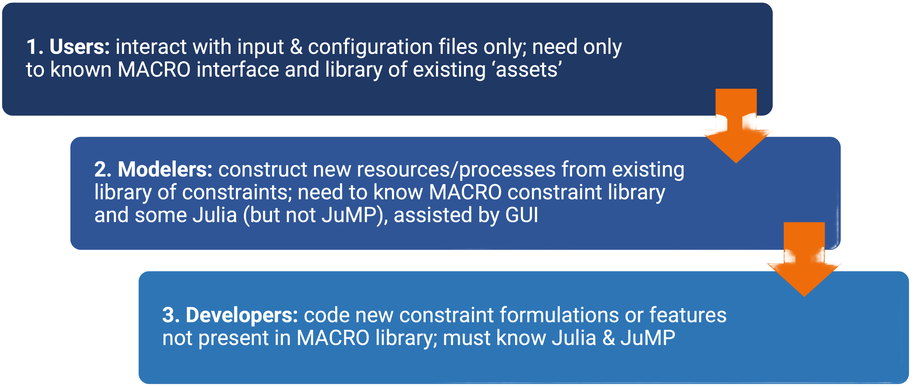

```@meta
CurrentModule = MacroEnergy
```

# Macro

**Welcome to the [Macro](https://github.com/macroenergy/MacroEnergy.jl.git) documentation!**

**This documentation is a work-in-progress, so please forgive our appearance as we add material.**

**All feedback is welcome and please report and errors or omissions through [the MacroEnergy.jl issues page.](https://github.com/macroenergy/MacroEnergy.jl/issues)**

## What is Macro?

**Macro** is a bottom-up, multi-sectoral infrastructure optimization model for macro-energy systems. It co-optimizes the design and operation of user-defined models of multi-sector energy systems and networks. Macro allows users to explore the impact of energy policies, technology costs and performance, demand patterns, and other factors on an energy system as a whole and as separate sectors.

The main features of Macro include:

- **Graph-based representation** of the energy system, facilitating clear representation and analysis of energy and mass flows between sectors.
- **"Plug and play" flexibility** for integrating new technologies and sectors, including electricity, hydrogen, heat, and transport.
- **High spatial and temporal resolution** to accurately capture sector dynamics.
- Designed for **distributed computing** to enable large-scale optimizations.
- Tailored **Benders decomposition** framework for optimization.
- **Open-source** built using Julia and JuMP.

## Structure of the documentation

The documentation contains five main sections:

- **[Getting Started](@ref)**: How to install Macro and run your first cases

- **[Tutorials](@ref)**: Long-form guides with worked examples, intended to help you learn how to use Macro

- **[Guides](@ref)**: Short guides which walk you through how to achieve specific tasks, intended to be a day-to-day reference when working with Macro

- **[Manual](@ref)**: A detailed description of Macro's components and features

- **[Reference](@ref "References")**: A function reference for Macro's API

## Recent changes

<!-- BEGIN GENERATED RECENT CHANGES -->
### 0.3.0 - rc - 2026-10-14
#### Added

- Added `@add_to_balance` for appending raw terms to an existing named balance.
- Added `@add_to_storage_balance` as the preferred helper for extending storage law-of-motion balances.
- Added `@inspect_stoichiometric_balance` to inspect the pairwise equations generated by `@add_stoichiometric_balance`.
- Added focused single-asset solve tests under `test/asset_tests` to validate migrated asset balances against manual algebraic rewrites where appropriate.
- Added scaling functionality for input data. New `ParameterScaling` (default `false`) and `ParameterScalingFactor` (default `1e3`) parameters have been added to case settings.
- Added capacity_summary.csv for multi-period cases, combining per-period capacity outputs into a single long- or wide-format file.
- Added optional StartYear input in case_settings.json to label periods by calendar year.
- Added `capex.csv` output file to report per-component asset capital costs.
- Added repository-local benchmarking tools to compare case loading, case generation, and model generation between `upstream/main` and the current worktree using reproducible example inputs.
- Added system-wide and per-location capacity constraints for selected groups of assets: `MaxCapacityConstraint` and `MinCapacityConstraint` bound total capacity, and `MaxNewCapacityConstraint` bounds newly built capacity. Limits are configured via a `constraints` block in `system_data.json` (whole system) or per location in `locations.json`, using asset-type and tag selectors. The limit values are scaled with `ParameterScaling` like other capacity inputs.
- For `VRE`, the optional `technology` input is normalized into an asset tag (for example, `technology: "Solar"` adds `:solar`) without changing the asset's Julia type.
- Added `ConstrainedFossilLiquidFuels`, a refinery asset with fixed jet-fuel and diesel output ratios and configurable fuel-specific emissions.
- Added optional auxiliary-fuel inputs to `BECCSHydrogen` and captured-CO₂ return flows to `SyntheticLiquidFuels`.
- Added unit-commitment support for `Electrolyzer` hydrogen output, including startup electricity consumption, minimum up/down times, and ramping limits.
- Added time-domain reduction (TDR) to replace full input time series with weighted representative periods. The new `preprocess_inputs` and `time_domain_reduction` workflows generate a separate reduced case that loads and runs through the ordinary MacroEnergy APIs.
- Added JSON-configured TDR with independent per-System settings, k-means, k-medoids and autoencoder clustering, feature selection and weights, scaling, and forced extreme-period selection.
- Added TDR input discovery for JSON and model-input CSV references across arbitrary directories, including inline time-series vectors. Per-System copies retain only required files and time-series columns, preserve model-input CSV format, and consolidate identical shared inputs.
- Added optional model-output clustering features from isolated candidate-period solves, with distributed execution, selective policy-constraint exclusion, retained inputs/results, and fingerprint-validated feature caches under the source case’s `TDR/` directory.
- Added support for reclustering into shorter representative periods while preserving source-period boundaries and occurrence weights. TDR reports trimmed timesteps, rejects longer requested periods, updates time settings, and validates source/destination separation before overwriting.
- Added TDR period maps, provenance and feature-use logs, including records of inputs reduced without being used for clustering. Preprocessing logs are saved under `preprocessing_logs/` in the reduced case.

#### Changed

- Cached repeated reads of shared CSV inputs within each case or system load, avoiding repeated full-file parsing when assets select different columns from the same file.
- `@add_balance` is now the recommended API for ordinary algebraic balance equations and inequalities, and follows standard algebraic sign conventions for `flow(...)` terms.
- `@add_balance` now validates balance expressions more strictly and rejects unsupported non-`flow(...)` variable terms.
- `@add_stoichiometric_balance` now expands recipe-style balances using a consistent proportional rule around the selected `base_term`.
- Asset balance definitions have been migrated away from legacy raw `balance_data = Dict(...)` patterns toward `@add_balance`, `@add_to_storage_balance`, and `@add_stoichiometric_balance`.
- Updated MacroEnergyScaling.jl compatibility to 0.4. Constraint scaling now updates constraints in place, so existing JuMP `ConstraintRef`s remain valid instead of being invalidated by constraint replacement. This version also allows for objective scaling in the future.
- Hoisted repeated time-data lookups during model construction and simplified ramping and minimum up/down-time constraints to avoid temporary expression and index containers.
- Weight policy slack to ensure CO2 slack penalty has economic interpretation.
- A constraint entry in a `constraints` block may now be an inline configuration object (carrying its settings) instead of only the boolean `true`/`false` toggle, enabling data-driven constraint parameterization.
- Location entries in `locations.json` may now be objects carrying a `constraints` block (bare id strings still work), allowing location-specific constraints to be loaded from input data.
- Reduced model-generation allocations in edge balance updates by inserting flow variables directly into vertex balance expressions instead of constructing temporary effective-flow expressions.
- `run_case` now scopes logging to the run, restores the caller’s logger, and closes its own file log stream on success or failure.
- Storage Charge/Discharge limit constraints now can be applied to `LongDurationStorage`.

#### Removed

- Removed `Revise` and `Test` from the package dependencies. `MacroEnergy.jl` no longer loads `Revise` at package load time, so developers who relied on that must now load it themselves; `Test` remains available to the test suite through `[extras]`/`[targets]`.

#### Fixed

- Myopic runs with `MyopicSettings.ReturnModels = false` now actually free each period's model. Each period's references are now released once its results have been written, and the model is emptied. Results are unchanged; scalar capacities remain readable on the returned `Case` as `Float64`.
- Fixed asset component traversal and Benders planning updates for assets whose optional edges are absent.
- `StorageChargeLimitConstraint` is now attached to a `Battery`'s charge edge. Before, it was declared as a top-level key in the charge edge's default data instead of inside its `constraints` dictionary, so it was silently dropped.
- Dual exports now handle unavailable solver duals safely, recording `NaN` instead of failing while preserving `Float64` output arrays.
- CSV input reading now releases file handles deterministically to allow immediate rewriting and deletion on Windows. JSON reads/writes and CSV header reads also close streams after exceptions.

#### Documentation

- Expanded the balance documentation with guidance on choosing between balance macros, stoichiometric coefficient bases, pairwise expansion limits, multi-term algebraic balances, common mistakes, and numerical sensitivity.
- Updated modeler documentation to include balance APIs in the asset-construction workflow and to recommend a small single-asset regression test for each new asset.
- Updated debugging guidance around `balance_data`, `get_balance`, and `@inspect_stoichiometric_balance`.
- Updated asset-specific documentation examples to use the balance macros instead of legacy raw balance dictionaries.
- Added preprocessing and TDR manuals covering configuration, input discovery, candidate construction, clustering, output-feature caching, generated files, and function workflow trees.

#### Migration guide

- When updating an asset, prefer `@add_balance` for ordinary algebraic equalities and inequalities, prefer `@add_to_storage_balance` for storage law-of-motion terms, and use `@add_stoichiometric_balance` only when the relationship is naturally a recipe-style proportional conversion.
- Legacy raw balance dictionaries should usually be replaced with explicit balance macros. For example:

```julia
transform.balance_data = Dict(
    :energy => Dict(
        output_edge.id => coeff,
        input_edge.id => 1.0,
    ),
)
```

can become:

```julia
@add_balance(transform, :energy, flow(output_edge) == coeff * flow(input_edge))
```

or, when the relationship is best represented as a recipe:

```julia
@add_stoichiometric_balance(
    transform,
    :production,
    coeff * flow(input_edge) --> flow(output_edge),
    flow(output_edge),
)
```

- Use `@add_balance` when the relationship is easiest to write as an explicit equation, includes three or more independently varying terms, or is not just a set of pairwise proportional relations.
- Use `@add_stoichiometric_balance` when one `base_term` should anchor several proportional relationships and all coefficients can be written on a common recipe basis.
- In one `@add_stoichiometric_balance` expression, all coefficients must share a common basis. For example, if the base term is product output, coefficients should usually be expressed per unit output; if the base term is fuel input, coefficients should usually be expressed per unit fuel.
- When extending the `:storage` balance of a storage component, use `@add_to_storage_balance(storage, coeff * flow(edge))`. In normal usage, write positive magnitudes for both inflows and outflows and let MacroEnergy apply the effective sign through edge direction.
- During migration, inspect generated pairwise equations with `@inspect_stoichiometric_balance(...)`, inspect stored coefficients with `balance_data(component, balance_id)`, inspect compiled expressions with `get_balance(component, balance_id)`, and validate the asset with a small single-asset solve test.
- Small differences in large-system results do not automatically indicate a balance bug. Algebraically equivalent formulations can change row scaling and solver tie-breaking in large, near-degenerate systems, so localized single-asset regression tests are the primary evidence that migrated balances remain correct.
- **Results change:** no public API changed, but any case using a `Battery` asset could now produce different results. The charge limit (`charge_flow[t] <= capacity - storage_level[t-1]`, scaled by the charge efficiency) was previously not included by default and is now enforced. To keep the old behavior, disable it explicitly on the charge edge: `"charge_edge": {"constraints": {"StorageChargeLimitConstraint": false}}`.
- If you set `StorageChargeLimitConstraint` as a top-level key on a charge edge, rather than inside that edge's `constraints` dictionary, it was and still is ignored. Move it inside `constraints` for it to take effect.
- `StorageChargeLimitConstraint` only applies to an edge whose end vertex is the storage, i.e. the charge edge. Setting it on the discharge edge (or via `discharge_constraints` in the simple input format) has no effect.

For the full release history, see [the changelog](@ref Changelog).
<!-- END GENERATED RECENT CHANGES -->

## Macro development strategy

Macro is a very flexible tool for modelling energy systems. However, that flexibility also means the core architecture and functions are complex and difficult to use correctly.

To make Macro as useful and accessible to the widest audience possible we designed and developed it with three layers of abstractions in mind, each serving a different user profile:



Due to these abstractions, users and modelers will be able to achieve their goals without needing to understand every aspect of Macro. The [guides section](@ref "Guides") of the documentation has guides for users, modelers, and developers.
